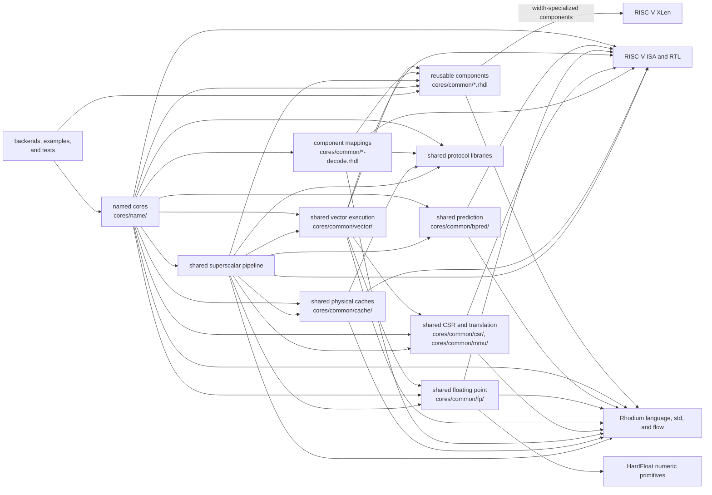

<!-- Guides contributors through placing, implementing, and validating processor components and cores. -->
<!-- SPDX-License-Identifier: Apache-2.0 -->

# Developing processor components and cores

Read the package [README](README.md) for the implementation catalog and
[`common/README.md`](common/README.md) for reusable components. This guide owns source placement, dependency
direction, extension workflow, and contributor validation.

## Choose the right home

Before adding a component, decide who owns its policy:

- Put small reusable execution blocks, data-shaping helpers, and integration
  contracts directly under `cores/common/`. Keep each component's instruction mapping
  beside it: `common/alu-decode.rhdl`, `common/branch-decode.rhdl`, `common/multiply-decode.rhdl`,
  `common/divide-decode.rhdl`, and `common/memory-decode.rhdl` describe component controls, not a whole core profile.
  Numeric datapaths consume already-decoded controls; only their mappings
  import instruction catalogs.
- Put substantial shared component families under `cores/common/`:
  [`common/csr/`](common/csr/DEVELOPING.md) owns CSR/trap state and
  [`common/mmu/`](common/mmu/DEVELOPING.md) owns translation contracts, TLBs, and PTW state;
  [`common/fp/`](common/fp/DEVELOPING.md) owns FP mappings, operand execution, and register storage.
  [`common/vector/`](common/vector/DEVELOPING.md) owns vector control relations, sequencing,
  register storage, packed execution, and persistent completion ownership.
  [`common/bpred/`](common/bpred/DEVELOPING.md) owns shared BTB/RAS state and prediction payloads;
  callers retain fetch geometry integration, redirect timing, and update qualification.
  [`common/fetch/`](common/fetch/DEVELOPING.md) owns physical fetch protocols and the
  fixed-cycle L1I/uncached router shared by superscalar and RV5Stage, parameterized
  by physical address and fetch widths.
  [`common/fetch/fault.rhdl`](common/fetch/fault.rhdl) owns shared block and instruction-relative
  faults; each assembler owns parcel selection and its core's exception priority.
  [`common/fetch/encoding.rhdl`](common/fetch/encoding.rhdl) shares stateless instruction expansion
  and parcel classification. Frontend stages, parcel buffering and issue windows
  stay in the owning cores.
  Organize common components by responsibility. They may depend on architectural
  `riscv/` definitions, but never on a pipeline's configuration or payloads.
- [`superscalar/`](superscalar/DEVELOPING.md) owns the complete, currently
  two/three-lane pipeline shared by the RV2Wide and RV3Wide named entry points,
  including its frontend, decode, configuration, and integration tests.
  Named RV2Wide/RV3Wide issue modules supply their admission policies through
  an elaboration-time circuit parameter; shared issue contracts and predicates
  stay in superscalar without reverse imports.
- Put reusable cache geometry, physical protocols, L1I/L1D state, and cache-side
  CHI engines in [`common/cache/`](common/cache/DEVELOPING.md). Completion context belongs
  to the caller and must remain opaque inside shared cache hardware.
- Put instruction decode, core-specific architectural integration, pipeline policy, adapters, and
  integrated tests under `cores/<name>/`.
- Put direct tests for standalone common components in [`common/tests/`](common/tests/)
  and family tests under that family's `tests/` directory, including rsim drivers
  and HDL-specific emitters and benches. Named-core and pipeline tests stay
  under their owning implementation's `tests/` directory.

A reusable component may use the closed RISC-V `XLen` configuration when its
contract is specifically RV32/RV64. Reusable component mappings may consume
architectural instruction catalogs, while complete
extension selection remains named-core policy. Named cores may depend on
reusable blocks, those mappings, Rhodium libraries, pure RISC-V ISA/RTL
support, and shared protocol libraries, but never on another named core.

## Dependency direction

Production code must not reverse an arrow toward consumers. Neither reusable
components nor named cores may import a backend, example, or test. Backend
consumers elaborate public designs from outside this package.
[`check-boundaries.sh`](check-boundaries.sh) enforces these rules across common
modules, shared families, and pipeline implementations, prevents imports of named-core policy, keeps CHI engines
independent of private cache implementations, and keeps generated bytecode out
of `cores/`.

## Change workflow

Choose the owner before editing. Common components own reusable physical
controls, protocols, and state; pipeline implementations own stage timing,
architectural context, recovery, and retirement. Named RV2Wide/RV3Wide variants
select the superscalar implementation and their issue policies.

Follow the [common component guide](common/DEVELOPING.md) for library changes
and the owning pipeline or named-core guide for implementation changes.
Move direct component tests with their implementation; integrated fixtures stay
with the pipeline or variant they exercise. Update imports, documentation,
fixture inventories, and simulator/CI source groups together when moving files.
Keep generated models, bytecode, and native binaries out of version control.

## Validation

Run the smallest owning host and behavioral checks from the common, pipeline,
or named-core guide. Run `moon run rhodium:check-boundaries` after moves or
dependency changes. The checker enforces that `common/` cannot import pipeline
implementations, named variants, or their tests, while the superscalar family
cannot depend on the variants that select it. Use repository-managed Racket
wrappers and the [test guide](../tools/testing/DEVELOPING.md).
