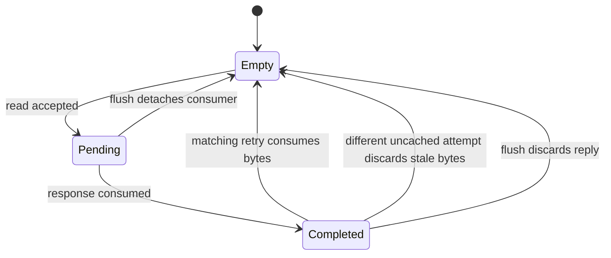

<!-- Describes shared physical fetch protocols and replay ownership. -->
<!-- SPDX-License-Identifier: Apache-2.0 -->

# Physical instruction memory

This package supplies physical fetch protocols and the fixed-cycle router shared
by RV5Stage and the superscalar pipeline. Frontends and MMUs retain translation,
architectural faults, parcel assembly, and recovery policy. See
[DEVELOPING.md](DEVELOPING.md) for implementation and validation.

```rhdl
import:
  lib("cores/common/fetch/memory.rhdl").InstructionMemoryRouter

inst memory(InstructionMemoryRouter(64, 32))
```

Connect `core` to a `PhysicalInstructionLookup(address_width, fetch_bits)`
requester, `cache` to shared L1I, and `uncached` to
`PhysicalInstructionAccess(address_width, fetch_bits)`. The latter returns
`PhysicalInstructionResp(fetch_bits)`: instruction bytes and an access fault.
It carries no translation fault or architectural exception state.

Before issuing a request, both cores use `qualify_physical_fetch` to check that
the original PC fits the core's address representation and the complete
physical block lies in an executable region. It returns permission and a
`PhysicalInstructionReq` with cacheability and device ordering resolved from
PMA and PBMT. The caller supplies the block start and size and selects the
architectural fault. [Fetch qualification](access.rhdl)

## Lookup and replay contract

Every surviving S1 request produces an S2 outcome one cycle later. `s1_kill`
suppresses the new attempt without suppressing the preceding S2 result.
Cacheable attempts use L1I's data/access-fault/replay result. An uncached attempt
returns replay immediately while one retained read runs; a later retry consumes
its completed bytes. There is no additional stage on cache hits.

The following illustrates the retained uncached owner:



Matching includes address, cacheability, and device ordering. Pending ownership
prevents duplicate reads; a different completed request replays and clears stale
data before another read can issue. `flush` cancels consumer ownership;
`invalidate_all` only invalidates L1I. The caller asserts both when its recovery
policy requires both. Accepted CHI work still drains after consumer cancellation.

The router accepts a physical address width independent of XLEN. By default,
uncached retries compare the entire byte address. A caller that already checks
the executable physical map can pass
`~executable_address_width: physical_map.executable_address_width`.
Then uncached attempts must fit that bound and be fetch-block aligned. Only the
retained retry key is narrowed; the cache and uncached ports still carry the
full address.

The supplied
[uncached CHI attachment](../cache/README.md#non-cacheable-service) supports
32- or 64-bit aligned fetches that fit its transport word. Permissions belong
to the caller. [Fault helpers](fault.rhdl) and [encoding helpers](encoding.rhdl)
are independent of this router.
