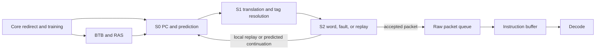

<!-- Defines RV5Stage fetch-pipeline and branch-predictor public entry points. -->
<!-- SPDX-License-Identifier: Apache-2.0 -->

# RV5Stage fetch

This package owns instruction acquisition from S0 request selection through
compressed instruction assembly at the Decode boundary. The integrated
[`RV5StageFrontend`](frontend.rhdl) presents fetch packets to the core; its
[`protocol.rhdl`](protocol.rhdl) defines the control and `FetchDecode` payloads.
The parent [microarchitecture guide](../README.md#microarchitecture) defines
observable stage timing, replay, fault, redirect, and reservation behavior. The sibling
[`icache/`](../icache/README.md) package owns instruction storage, refill, and
coherence. Contributors should read [DEVELOPING.md](DEVELOPING.md) for source
ownership, dependency direction, and focused validation.

## Fetch and prediction flow

The diagram illustrates the current fetch composition, not a promise about
internal predictor storage. S0 launches a virtual request; S1 correlates its
physical resolution, and S2 produces a word, fault, or replay. The frontend
queues raw packets, while the core's instruction buffer assembles compressed
and straddling instructions for Decode.

An accepted refill or uncached read drains through a speculative flush; a
replay retries the oldest failed PC. The [instruction cache](../icache/README.md)
owns refill and storage, not fetch sequencing.

Branch prediction uses the shared [`cores/bpred/`](../../bpred/README.md)
components. Their [`protocol.rhdl`](../../bpred/protocol.rhdl) defines prediction and training payloads,
while the parent [branch-prediction contract](../README.md#branch-prediction)
defines their observable policy and generator parameters.

S2 refreshes a warm return prediction from the live stack before applying its
action. If an older call changed the head after S1 lookup, this late correction
redirects younger fetch work without invalidating the return entry. A straddling
return retains its corrected target until its continuation arrives; the prefix's
stack action is not repeated. Faults suppress corrections, and an empty stack
preserves the BTB target.
Integrated frontends compact speculative destinations to the configured
successful-PC width, covering Sv39 and Bare physical addresses. The BTB, RAS,
and S2 fallback paths use the same normalization before fetch steering and
prediction capture. Out-of-range targets can alias valid addresses; execution
checks the exact architectural next PC and squashes a mistaken path. Recovery
PCs and fault addresses are never truncated. Standalone frontends without a
physical-address bound retain XLEN-wide predictions.
BTB source PCs use the same bound without aliasing: out-of-range lookups miss,
and training or invalidation cannot modify an in-range entry with matching low bits.

Each nonfaulting packet carries its full predicted target and return-stack action,
but identifies the predicted instruction by parcel, not by a second PC.
`Lower` and `Upper` name the halfwords in this word. `Previous` names the
upper halfword of the preceding word: its 32-bit instruction finishes in this
packet, so its prediction may only become known here. `None` means no prediction.
The instruction buffer applies a hint only to its owner, including while Decode
is stalled. A fault suppresses the hint without changing the fault address.

The five-entry queue may store fewer PC bits than XLEN. Decode still sees the
exact instruction PC and, if a straddling fetch faults, the address of its
failing parcel. Neither case requires an extra cycle or queue entry.

`FetchDecode.fault` uses shared `FetchFault(xlen, hypervisor)` from
`cores/fetch/fault.rhdl`. Its cause selects access faults before page faults;
the guest-page cause is used only when H is enabled. The continuation bit names
the second parcel, so `fault.address(pc)` recovers the precise fault VA without
storing another address. Guest metadata adjusts the byte offset for explicit
fetches and preserves implicit page-table-read GPAs. Faults suppress predictions;
illegal instruction encodings remain a separate Decode decision.
