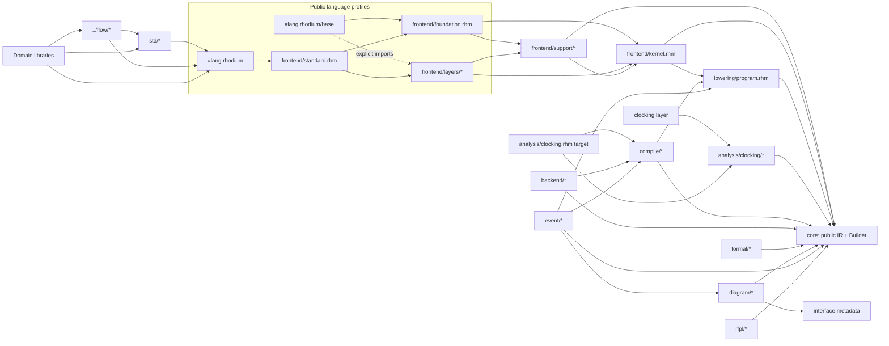

<!-- Defines the Rhodium implementation package graph and contributor dependency contract. -->
<!-- SPDX-License-Identifier: Apache-2.0 -->

# Developing Rhodium

Read the package [`README.md`](README.md) first for its public profiles,
interfaces, and consumer-facing package map. This guide owns Rhodium's
implementation boundaries and direct-dependency contract. For repository-wide
development setup and workflow, see the project [`DEVELOPING.md`](../DEVELOPING.md).

Rhodium has one backend-independent hardware model and several authoring
profiles. Every frontend path elaborates into the same public core IR; frontend
syntax is not a second IR.

## Implementation architecture

Arrows mean "may depend directly on." They point inward toward the public IR;
no reverse dependency is allowed.

`#lang rhodium` is the curated language. `#lang rhodium/base` is the composition
profile: it exposes the foundation and allows a program to import only the
language layers it wants. The word *base* names the public profile; the
internal module implementing its shared frontend forms is called the
*foundation*. The frontend guide explains
[profile selection and elaboration](frontend/README.md).
Remaining named-domain, reset-domain, and semantic-transfer work is tracked in
the [clocking plan](CLOCKING_PLAN.md).

## Dependency rules

- Core never imports compilation, lowering, analysis, frontend, backend, or RFPL code.
- Graph materialization depends only on core. It owns program materialization;
  backend selection and frontend construction remain outside that package.
- Compilation depends only on core and graph materialization. Targets are explicit
  objects supplied by callers; compilation never imports a backend registry.
- Internal analysis consumes completed core IR and does not import authoring,
  compilation, or lowering packages. Only `analysis/clocking.rhm`, the public
  target adapter, imports neutral compile contracts and RTL preparation.
- Frontend code never imports a backend. Frontend layers do not import sibling
  layers; reusable cross-layer machinery belongs in `frontend/support/`.
- Backend emitters and formal tools consume verified core IR without importing
  frontend syntax or elaboration. Optional backend target adapters may import
  neutral compile contracts and preparation helpers; they do not import lowering
  directly.
- Standard, flow, and domain libraries use the public language rather than
  Rhodium implementation modules. Flow may depend on std, but std and Rhodium
  implementation packages must not import flow. Flow must not import downstream
  domain libraries.
- RFPL and diagram generation are downstream views. They inspect public IR but
  do not participate in hardware construction.
- SoCs do not depend on simulators. Simulation and VLSI integration depend
  inward on public SoC, backend, SRAM, and harness surfaces.
- SRAM mapping consumes post-CIRCT MLIR. Rhodium implementation packages and
  SoCs do not import it, and generic mapping code owns no foundry policy.

## Package responsibilities

| Area | Responsibility | May depend directly on |
|---|---|---|
| [`../support/`](../support/README.md) | Pure host refinements, shared type/literal protocols, immutable enum/variant descriptions, and the host-safe `hardware_enum` declaration | Rhombus and other pure support modules only |
| [`core/`](core/README.md) | Structural types, IR, Builder, verification, and printing | Other core modules, pure `../support/` protocols/refinements, and Rhombus libraries |
| [`lowering/`](lowering/README.md) | Reachable graph copying and extension certification after verification | Core IR, Builder, verifier; local graph copier |
| [`compile/`](compile/README.md) | Explicit target orchestration, concrete RTL inspection target, in-memory artifacts, and physical boundary manifests | Core IR/signatures and verifier; graph materialization; neutral local contracts |
| [`analysis/`](analysis/README.md) | Clock compile target plus internal certification, provenance, and diagnostics | Core and analysis modules; only `clocking.rhm` imports neutral compile contracts and RTL preparation |
| [`frontend/kernel.rhm`](frontend/kernel.rhm) | Context-sensitive elaboration, signature-bearing definition references and layer-owned boundary declarations, checked literal/deferred-value materialization | Core IR, signatures, Builder; `lowering/program.rhm`; pure hardware-data protocols |
| [`frontend/support/`](frontend/support/) | Shared cross-layer macros, static-information machinery, and policy certification; not a language profile | Kernel, approved core APIs, approved analyses, other frontend support modules, pure host support |
| [`frontend/foundation.rhm`](frontend/foundation.rhm) | Circuits, ports, connections, elaboration, basic types including callable `Bits` descriptors and `Bool`, extension-defined hardware type declarations and protocols, receiver-owned scalar membership and width extension, selection, and representation methods | Kernel, support including bit-descriptor support, approved core type APIs |
| [`frontend/layers/`](frontend/layers/README.md) | Independently selectable notation and abstractions over existing semantics | Kernel, support, approved core APIs and analyses |
| [`frontend/standard.rhm`](frontend/standard.rhm) | Aggregation only; defines no feature behavior | Foundation and all standard layers |
| [`language.rhm`](language.rhm), [`base/language.rhm`](base/language.rhm) | Compose ordinary Rhombus host control with one public Rhodium profile | Standard or foundation |
| [`../rfpl/`](../rfpl/README.md) | Physical views over existing modules: opaque hard macros and wiring-only composite floorplans with contained child coordinates | Public core IR only |
| [`diagram/`](diagram/README.md) | Read-only logical block, hierarchy, compound-interface, and flow visualization with JSON and DOT output | Core IR and interface-owned nonsemantic metadata |
| [`event/`](event/README.md) | Static dependency inference, immutable metadata/DPI instrumentation, and manifest/descriptor generation | Core IR, Builder, verifier, portable IR remapper and metadata certification, neutral compile contracts and RTL pipeline in `trace-pass.rhm`, logical diagrams, interface-owned instance-context metadata, other event modules, and Racket JSON string encoding |
| [`statistics/`](statistics/README.md) | Optional per-occurrence sampled-count RTL pass and descriptors | Core IR/Builder, neutral compile contracts/pipeline/preparation, `event/copy.rhm`, statistics declaration metadata, Racket JSON string encoding |
| [`../rheg/`](../rheg/README.md) | Independent C++ event collector, manifest-bound snapshots, and streaming/standalone Perfetto export | Runtime: C++ standard library only; exporter: runtime and private nlohmann JSON dependency |
| [`std/`](std/README.md) | Optional host utilities, protocols, and circuit generators written in ordinary Rhodium | Public `#lang rhodium` authoring surface only |
| [`../flow/`](../flow/README.md) | Streaming buffers, arbitration, routing, packet adapters, and configured topology stages | Public `#lang rhodium`; focused `std/` modules; other flow modules |
| [`backend/`](backend/README.md) | Consume verified public IR; independent CIRCT, direct SystemVerilog, and typed C++ simulation targets | Core; neutral compile contracts and RTL preparation only in target adapters |
| [`formal/`](formal/README.md) | Optional Rosette-backed behavioral equivalence, output reachability, and combinational output properties over verified public IR | Core only; Rosette through one Racket interoperability module |
| [`../chi/`](../chi/README.md) | AMBA CHI flits, links, monitors, fabric metadata, coherent Homes, shared memory control, single-beat subordinate transactions, and cache maintenance | Public `#lang rhodium`; protocol-neutral `std/` libraries and root-level `flow/`, including `std/ready-valid.rhdl` for monitor transfer events, Home snoop-target tracking, and the single-beat subordinate engine, `std/bits.rhdl` and `flow/main.rhdl` for service matching, shared memory control, and maintenance, and `std/read-write.rhdl` and `std/sync-ram.rhdl` only for the concrete RAM backend within the memory stack |
| [`../socs/`](../socs/README.md) | Concrete system composition and end-to-end integration | Public domain-library and core surfaces only |
| [`../cores/common/`](../cores/common/README.md) | Cross-pipeline execution blocks, fetch and memory contracts, architectural-state components, and host configuration helpers | Public Rhodium/Flow, architectural RISC-V definitions, CHI, and HardFloat as permitted by child guides; no pipeline implementation, named-core policy, simulator, or backend |
| [`../cores/common/cache/`](../cores/common/cache/README.md) | Shared physical L1I/L1D, cache protocols, geometry, and cache-side CHI engines | Public Rhodium/Flow, shared execution components, CHI, and RISC-V physical-operation/map vocabulary; no named core |
| [`../cores/common/csr/`](../cores/common/csr/README.md) | Shared CSR/trap, privilege, counter, FP, vector, and optional guest state | Public Rhodium/Flow, architectural RISC-V descriptors/adapters, and passive core observation declarations; no named core |
| [`../cores/common/mmu/`](../cores/common/mmu/README.md) | Shared host/guest translation contracts, TLB storage, and page-table walking | Public Rhodium/Flow and architectural RISC-V descriptors/adapters; no named core or cache arbitration |
| [`../cores/common/fp/`](../cores/common/fp/README.md) | Shared FP controls/decode, opaque-tag operand execution, and register-file storage | Public Rhodium/Flow, architectural RISC-V descriptors/helpers, and HardFloat; no named core |
| [`../cores/common/bpred/`](../cores/common/bpred/README.md) | Shared branch-target, direction-table, and return-address prediction state and payloads | Public Rhodium/Flow, XLEN and RISC-V instruction-field helpers; no named core or fetch consumer |
| [`../sims/`](../sims/README.md) | Executable SoC harnesses, FESVR host model, target payloads, and simulator bindings | Public SoC, RISC-V PMA descriptors, CHI, flow, device (`devices/uart/uart-dpi.rhdl`), and Rhodium surfaces; explicit compilation targets; optional event instrumentation and RHEG export; external C++ libraries |
| [`../sram/`](../sram/README.md) | Technology-independent post-CIRCT memory-site selection, macro-interface adaptation, tiling, and manifests | CIRCT/MLIR libraries; technology catalogs beneath `sram/` |
| [`../riscv/rtl/`](../riscv/rtl/README.md) | Converts RISC-V instruction encodings into generic typed decode patterns | Pure RISC-V model; public `#lang rhodium` libraries |
| [`../hardfloat/`](../hardfloat/README.md) | Rhodium port of Berkeley HardFloat representations and floating-point units | Public `#lang rhodium` authoring surface only |
| [`../vlsi/`](../vlsi/README.md) | Physical-design integration, design/technology policy, and mapped simulation | Public authoring/compilation surfaces; `sram/`; `sims/`; external VLSI tools and harnesses |

`compile/program.rhm` imports compile contracts and core `DesignElaboration`;
`compile/rtl.rhm` alone adds the graph materializer to ordinary RTL preparation.
The `backend/rsim-target.rhm` adapter imports compile contracts and shared `RTLTarget` preparation,
and its local scheduler, decode specialization/table planning, scalar CSE and
array-update passes, evaluation liveness, and emitter.
`backend/rsim/plan.rhm` imports core IR/types and dependency identity lookup. `backend/rsim/cse.rhm`
imports core types and local schedule descriptors for exact expression sharing
and value remapping. `backend/rsim/decode.rhm` imports core types and local
schedule descriptors for canonical known-bit specialization and bounded lookup
table planning. `backend/rsim/array-updates.rhm` imports core types, local
schedule descriptors, and evaluation dependencies for exact update recognition
and removal of unused value cones. `backend/rsim/evaluation.rhm` imports the
local schedule and register-array assignment descriptors for value/storage
dependencies, shared schedule pruning, and evaluation planning. `backend/rsim/register-arrays.rhm` imports
core types and local schedule descriptors to fold exclusive array update trees
into register destinations.
`backend/rsim/regions.rhm` imports core types and local schedule/evaluation
descriptors for cost-based partitioning and boundary liveness.
`backend/rsim/conditional.rhm` imports local schedule/evaluation descriptors
and the region step-cost estimator for bounded conditional value and consumer evaluation.
`backend/rsim/layout.rhm` imports core types, local schedule/region descriptors,
and the C++ type helper for backing and scratch planning.
`backend/rsim/arrays.rhm` imports only the local layout descriptors and scratch
lookup helper for constructor-run recognition.
`backend/rsim/cache.rhm` imports local schedule/evaluation/region/layout
descriptors for owned-result eligibility and resource invalidation.
`backend/rsim/emit.rhm` imports core types, local schedule/evaluation/region,
layout/array/conditional/cache modules, and `backend/rsim/types.rhm`. It also uses Rhombus runtime
paths and Racket file/base primitives to read its local C++ support header at
emission time. The type helper imports core types
for C++ representation and packing. `backend/rsim/sv-binding.rhm` imports core
IR/types, detached module signatures, and the local schedule/type helpers for clocked-boundary validation
and SV/C++ binding emission. These implementations import no other
backend, portable lowering, frontend, or domain libraries.

The event compiler and RHEG exchange generated descriptors and fixed DPI calls;
neither imports the other's implementation. Event inference consumes generic
interface metadata, not `flow` library implementation modules.

CHI consumers in cores, devices, SoCs, and simulators depend directly on the
defining CHI modules and on `std/interconnect.rhdl` for generic address/transfer
types. The compatibility facade is not a production dependency boundary; the
[CHI import guide](../chi/README.md#package-boundary-and-import) and its
developer implementation map identify the owners.
CHI's `protocol/`, `transactions/`, `home/`, `subordinate/`, `adapters/`, and
`noc/` directories refine that source ownership without changing package
dependency direction. The CHI boundary checker audits nested production files;
the pure `chi/noc/noc-authoring.rhm` bridge still imports only host NoC/support
modules, not Rhodium or CIRCT.

HardFloat is representative of an external domain library over the public
language: Rhodium implementation packages do not depend on it, while its tests
may consume a backend to validate ordinary lowering.

## Design commitments

- Keep one public hardware IR until a concrete feature requires another.
- Keep frontend conveniences out of core when existing hardware semantics are
  sufficient.
- Keep optional reports and policy analyses outside the core API when they can
  derive their facts from completed IR.
- Keep backends independent of frontend syntax and metadata.
- Keep portable materialization separate from target emission. CIRCT is the
  current production target; alternative targets must preserve public semantics.
- Keep widths explicit and elaboration deterministic.
- Keep generator parameters stable and immutable in the host language and runtime data in hardware.
- Specify and test implicit conversion, connection, priority, or reset behavior
  before adding it.

## Auditable direct-dependency inventories

The architecture above is the implementation contract. The tables below are
its review surface: keep them exact when modules or layer imports change. They list
direct Rhodium dependencies, not the full transitive closure.

The reusable packed execution module `cores/common/simd-alu.rhdl` directly imports
`std/bits.rhdl` for bit reversal and leading-zero count, `std/reduction.rhdl`
for parallel compression ranks, and `riscv/isa/xlen.rhm`
for the closed RV32/RV64 host configuration. Its remaining hardware operations
use the public language; it imports no instruction catalog or named core.
Its explicit `XLen` specialization prunes datapath width and element cases.
`cores/common/simd-multiplier.rhdl` directly imports `flow/main.rhdl` for feed-forward
fork/map/pipeline connections, `std/bits.rhdl` for power-of-two physical geometry,
and the reusable scalar multiplier and SIMD width/rounding types. It takes
physical dimensions, not XLEN, and imports no vector sequencer, instruction
catalog, or named-core policy.
`cores/common/vector-layout.rhm` is pure host physical-row geometry over
`riscv/isa/vector.rhm`, with XLEN-derived word geometry from `riscv/isa/xlen.rhm`.
Shared vector storage, sequencing, packing, scanning, and completion consumers import
that layout explicitly and select `xlen.width` rows; architectural vector
descriptors own no physical rows.

The reusable `cores/common/*-decode.rhdl` mappings directly import `std/decode.rhdl` to map
pure RISC-V instruction catalogs onto root processor-component controls.
`cores/common/memory-decode.rhdl` also consumes architectural `XLen` to select the
catalog and leave full-width load extension unconstrained.
`cores/common/cache/` owns shared cache hardware, not architectural completion policy.
Its protocols use public ready-valid and Bits helpers, XLEN, memory-width,
atomic, and locality types. `config.rhm` uses core index-width calculation and
the stable generator-parameter contract. L1D uses Flow, `std/bits.rhdl`,
`std/plru.rhdl`, and `std/read-write.rhdl`; arrays additionally use
`std/sync-ram.rhdl`, and the store buffer uses `std/reduction.rhdl`.
L1I uses the same Flow, Bits, PLRU, read-write, and SyncRam APIs, plus shared
prefetch types. Its physical block result contains data/access-fault/replay,
never named-core translation metadata. `cores/common/fetch/protocol.rhdl`
imports the neutral L1I result and public ready-valid contracts.
`fetch/access.rhdl` uses that request type, shared compact PCs, architectural XLEN,
PMA/PBMT, and the power-of-two size annotation for physical block qualification.
`fetch/memory.rhdl` adds Flow for shared fixed-cycle physical lookup and retained
uncached replay. Both RV5Stage and superscalar compose this router; their MMUs
and frontends retain translation, exception adaptation, and cancellation policy.
The shared line-read engine owns coherent RAM/immutable-ROM snapshot transport.
Cache-side CHI engines consume shared flits, retry control, and the neutral
`cores/common/chi-hart.rhdl` map, never named-core code. Nonallocating CHI uses
the shared LoadGen; the IOMSHR uses StoreGen to align the retained write
payload at admission and Flow to attach its retained
context to the physical response. `cache/uncached-instruction.rhdl` imports the shared fetch
protocol, CHI transport/arbiter, physical memory contracts, hart map, XLEN,
locality types, Flow, `std/bits.rhdl`, and CHI channels. It shapes fetches
without owning frontend recovery policy. `cache/ordered-service.rhdl` imports
Flow, XLEN, the physical memory protocol, PMA map type, and IOMSHR. It attaches the cache
and IO slot to shared drain/capacity gating, local completion storage, and
response arbitration. Both cores retain PMA routing, fault reporting, and
beat adaptation.
`cores/common/vector/service.rhdl` directly imports shared FP profile/bundles/FPR
write contracts, integer execution, register write, multiplier/divider, vector tags,
XLEN, `std/bits.rhdl`, and ready-valid. The backend and pipeline adapters import
this common interface rather than redeclaring arithmetic/results/status ports.
LSU contracts, admission timing, precise outcomes, and FPR scheduling policy
remain outside the interface.
The superscalar bundles, frontend, MMU, and cache adapter import
`riscv/rtl/svpbmt.rhdl` for PBMT metadata and effective attributes.
Its request bundles additionally import the
shared `MemoryWidth`, and its decode imports the pure Zifencei, Zicboz, Zicbom,
Zicbop, Zawrs, Zihintpause, and Zihintntl catalogs;
its `rv2wide.rhdl` composition uses Flow to connect the frontend, execution slice,
and shared L1I/L1D. `frontend.rhdl` consumes the neutral L1I protocol and hart
physical map, RISC-V trap causes, `std/bits.rhdl` alignment helpers, and Flow
pipes and forks; it imports no other named-core implementation.
Its `instruction-assembler.rhdl` uses Flow's ShiftQueue for returned blocks,
the shared `riscv/rtl/compressed.rhdl` expander, pure XLEN descriptors, and public
Bits helpers. Canonical decode remains RV2Wide-owned. Its core, vector LSU, and decoder import `riscv/rtl/zihintntl.rhdl` for architectural locality metadata.
Its core, bundles, decoder, memory adapter, translation services, cache adapter,
and top consume the neutral `cores/common/cache-prefetch.rhdl` operation/request contract for
WB-authorized, nonfaulting I/D hints. Its profile and UDB
projection publish optional Zawrs; the core uses architectural CSR-field and
privilege helpers for its WB reservation-wait timeout policy. Its profile and UDB
projection import the pure `riscv/isa/c.rhm` compressed-extension descriptors;
the profile supplies the same selected C/Zcb/Zcmop list to the assembler and
shared CSR bank, preserving IALIGN and architectural publication consistency.
The shared cache operation type imports the architectural Sv39 access class
for data translation. The shared physical cache protocol imports the architectural PBMT type for
`PhysicalDataReq`. Superscalar bundles, physical transport, and the RV5Stage
physical port consume this payload. The RV5Stage protocol uses Rhombus meta
for its native-width alias. The superscalar data translation contract uses the
architectural exception cause and guest-fault types directly. `cores/superscalar/memory/translation-sv39.rhdl` imports the shared `cores/common/mmu/` TLB/walker,
shared cache protocol/operation/geometry and hart CHI-map definitions, and architectural
hypervisor, Sv39, and XLEN helpers. Both MMUs use the shared context module
to decode architectural CSRs and select effective data privilege for lookup construction. The superscalar adapters
use the shared cache access helpers for whole-block maintenance permissions.
`cores/superscalar/memory/adapter.rhdl` consumes the family bundles, shared cache
protocol, specialization-owned physical map, split engine, Flow, passive
observation helpers, and architectural
XLEN, guest-fault, pointer-masking, PBMT, and CMO descriptors plus `std/bits.rhdl`
alignment helpers, without importing the TLB/walker.
The top selects the identity or Sv39 specialization via `riscv/isa/hart.rhm`
and supplies it directly to the shared memory adapter. XLEN-specialized pipeline
and service payloads consume `riscv/isa/xlen.rhm`; operand and combined decode
also import the canonical `riscv/isa/rv32i.rhm` catalog.
`cores/superscalar/pairing.rhdl` consumes that catalog through
`riscv/rtl/instruction-pattern.rhdl` and `std/decode.rhdl` to recognize
AUIPC+ADDI without duplicating instruction encodings.
The memory adapter owns EX/MEM translation alignment and its transport owns
WB/split/PTE arbitration; the cache package has no reverse dependency. The adapter
and core also consume `cores/common/misaligned-access.rhdl`: the neutral split
request/result contract and retained fragment engine. This shared module imports
the physical cache protocol, cache operations, load/store shaping, architectural
XLEN/guest-fault types, Bits helpers, and Flow, never a named core's payload.
The `cores/superscalar/` family owns the shared two/three-lane integer implementation
behind RV2Wide and RV3Wide. Each named core owns its config class and hart
circuit. Configs import the shared `SuperscalarPipelineConfig` and retain it as
their sole `pipeline` field. Shared defaults and validation remain in the family.
Named configs additionally import architectural ISA/hart and shared CSR types
for their three derived metadata properties. Hart and host entry-point factories
consume the contained value when instantiating the shared fetching top;
execution-slice consumers call `SuperscalarCore` directly with it and an explicit
`~issue` circuit supplied by the named core.
UDB adapters pass it to the shared publication function. Neither named
core imports the other. Named hart circuits import Flow and CHI channels plus
the neutral hart identity and interrupt descriptors; no shared hart wrapper
remains. Internal generators and payloads use the `Superscalar` prefix.
The RV2Wide integration dependencies below now belong to this shared family,
including its implementation configuration and decode. Its production sources never import
the named facades. `socs/configs/rv2wide-core-profile.rhm` and
`socs/configs/rv3wide-core-profile.rhm` construct the shared pipeline config from
pure architectural presets and wrap it in their respective named config;
`socs/harts/rv3wide.rhdl` binds
its hart through the same neutral implementation and cache CHI attachment
contracts as RV2Wide. The resolver and metadata projection select each named
profile without adding a dependency between cores. Existing `rv2wide` cosim contract/DPI identities are unchanged;
the simulation-owned capture imports the shared bundles and configuration.

The family's `vector.rhdl`/`vector-memory.rhdl` adapters consume shared
`cores/common/vector/`, `cores/common/mmu/vector.rhdl`, integer/FP service contracts, and the
public Flow and `std/bits.rhdl` APIs. The adapters use architectural XLEN,
vector-state, pointer-mask, trap, guest-fault, PBMT, atomic, and locality helpers
from `riscv/`, plus HardFloat rounding types through shared FP descriptors.
They do not import RV5Stage. Scalar WB admission and translation arbitration
remain RV2Wide-owned, not dependencies of the shared vector package.
Its core and pipeline bundles consume the shared vector descriptor/control
types; the core also imports `cores/common/vector/precheck.rhdl` for footprint geometry
and `std/bits.rhdl` for range alignment. Bare/Sv39 translation consume the shared
`cores/common/mmu/vector.rhdl` fast-check contract and `vector-window.rhdl` page-PMA helper.
Its decoder joins the canonical V catalog into the ordinary decode
relation. The host profile consumes vector-profile and VLEN descriptors and
`std/bits.rhdl` capacity annotations. `memory-ports.rhdl` uses Flow to retain
scalar/vector response ownership; the identity and Sv39 services consume the shared
MMU vector-window contract. The scalar arithmetic adapters consume opaque
integer-service and vector completion tags, without importing another core.
RV2Wide bundles
also consume the architectural privilege type, and its core selects Sv39 through
the shared hart MMU-type descriptor.
`cores/superscalar/decode/` also imports `std/decode.rhdl` for exact-pattern column
composition and one hardware decoder per issue slot, plus the architectural
XLEN descriptor to select the shared F/D/Zfa instruction/control relations.
Its combined relation consumes the named core's `profile.rhm` configuration;
core decode and compressed predecode share that selection without duplicating
feature arguments. The pure configuration has no reverse dependency on RTL.
Its system and combined control relations also import the pure
`riscv/isa/svinval.rhm` catalog; optional invalidation reuses shared CSR actions
and the existing WB/MMU ownership boundary.
Both hardware backends consume `cores/common/fetch/redirect.rhdl` for rejected-target
classification. It imports architectural XLEN, CSR, privilege, Sv39, hypervisor,
and trap definitions only; retirement ordering and retained state stay in the cores.
`cores/superscalar/core.rhdl`
imports it to consume the combined decoder, `std/scoreboard.rhdl` for committed
load destinations, and `flow/main.rhdl` for typed endpoints, feed-forward
pipeline storage, and fault retention. `bundles.rhdl`, `issue-window.rhdl`,
`branch-training.rhdl`, and `memory-completion.rhdl` import the same Flow facade
for stream contracts, instruction/retired-training storage, credit accounting,
and returned-context routing. `cores/common/memory-response.rhdl` supplies the
generic data/context result and retagging method using public types and Flow.
Superscalar bundles import that contract and `std/bits.rhdl` for owner geometry.
The memory adapter, physical transport, and cache attachment carry opaque context;
the pipeline defines scalar/vector/management interpretation. Physical-client
routing and uncached byte offsets wrap that context without interpreting it.
`cores/superscalar/read-operands.rhdl` imports the family's operand/result
bundles, pairing control types, shared immediate extraction, architectural XLEN,
and the Flow endpoint annotation. It owns fixed four-path read routing,
interstage forwarding, operand muxes, and composed-immediate arithmetic;
the core retains register-file
storage and deferred-return/scoreboard policy. `cores/superscalar/issue.rhdl`
imports the read-routing and pairing helpers, decoded controls, lane PC geometry, XLEN,
CSR command classification, cache operations, and FP/vector control types.
It also imports core IR/signature/types and frontend circuit-reference APIs to
validate the supplied component's interface. It owns shared contracts, dependency
predicates, control-only instruction records, and write allocation. Named `cores/rv2wide/issue.rhdl` and
`cores/rv3wide/issue.rhdl` depend on these shared helpers and own their complete
prefix decisions. Their harts/factories pass the selected circuit through
`~issue`; shared core/top consume a Module or CircuitDefinition, with no
named-core import. The core retains resource state, bookings and retirement.
RV2Wide's `pairing.rhdl` imports its composed control, shared ALU/operand types,
system-control types, cache-operation enum, and canonical instruction fields/patterns.
The named issue circuits use its recognition and mux-control helpers internally;
`bundles.rhdl` defines datapath operand storage and imports the folded-immediate
width. `core.rhdl` applies the emitted controls through `read-operands.rhdl`,
captures its result, and applies EX/MEM forwarding controls. No shared
component or architectural catalog depends on this named-core policy.
RV2Wide's bundles also import the shared `cores/common/branch-resolver.rhdl` control
payload for registered MEM comparison; operand bypass and recovery remain core policy.
RV2Wide's `decode/long-ctrl.rhdl` consumes the reusable RISC-V multiply/divide
relations and pure M/Zmmul catalogs; the composed decoder retains unused-field
care masks. `long-execution.rhdl` directly instantiates the shared pipelined
multiplier and iterative divider with Flow owner storage. Its core consumes
the shared request types and arbitrates all deferred results through Flow.
The RV2Wide decoder also consumes the pure B/Zba/Zbb/Zbs catalogs and joins
the existing shared `RV64BAluCases` relation; operand and inactive memory/system
columns remain named-core policy. No additional ALU or named-core dependency is introduced.
Its decoder imports the pure Zicond/Zimop catalogs, joins the shared
`ZicondAluCases`, and selects constant-zero operands for MOPs; operand-use,
writeback, and nonserializing system policy remain RV2Wide-owned.
RV2Wide's decoder also imports the pure A catalog and architectural atomic
operation type. Its memory controls and request bundles use shared
`cache/operation.rhdl`; the core owns WB authorization/order and the response
unit distinguishes raw ordinary beats from already-normalized atomic values.
Reservation and RMW implementation remain in the shared L1D.
The slice uses public language register/vector operations and shared execution
components; it imports no named core or compiler implementation.
`cores/common/register-file.rhdl` directly imports `std/ready-valid.rhdl`, architectural
XLEN, and the shared `RegisterFileWrite` payload. It owns configurable-read,
two-write storage without named-core dependencies or port-allocation policy.
RV5Stage selects 2R2W and owns write-to-ID forwarding; RV2Wide selects 4R2W
while retaining forwarding, admission, and write-cycle reservations.
`cores/common/writeback-calendar.rhdl` owns the shared fixed-return reservation calendar
and directly imports Flow. RV5Stage scalar/vector and RV2Wide consumers own
port policy and latency selection. RV2Wide's `fp.rhdl` directly imports the
shared FP execution, timing, register-file, and load-boxing APIs plus Flow,
pure FP/XLEN descriptors, and that calendar. Its composed decoder imports the
shared FP control relation and pure register-bank metadata. No dependency on
RV5Stage is introduced.
Both named cores' pipeline bundles, cores, and vector adapters, RV2Wide's FP
adapter, and the shared vector backend/completion/pipeline/FP adapter directly
import `cores/common/fp/profile.rhm` for the native FP transport selector, keeping
RV32F/RV64D payload widths consistent independently of enabled ISA features.
`cores/superscalar/lane-pipe.rhdl` imports vector descriptor/certificate and
RISC-V vector state, rounding and pointer-masking types for the canonical EX
record. Pipeline records and scalar address views use public authoring APIs,
not frontend kernel reflection or separate expanded bundle families.
RV2Wide's `profile.rhm` imports the stable generator-parameter contract and
shared cache geometry alongside pure ISA/hart descriptors and the shared CSR
configuration used by both RTL and WARL metadata. `hart.rhdl` uses
Flow and CHI channels to adapt its reset-started processor to the neutral SoC
ports. Its UDB projection imports only pure RISC-V and support descriptors.
The shared `cores/common/cache/chi/attachment.rhdl` describes the three cache endpoints
using CHI protocol/transaction capabilities and the neutral hart identities.
RV5Stage's CHI facade and the RV2Wide SoC binding consume it; there is no
dependency between the named cores.
`sims/cosim/events/hooks.rhdl` uses public language DPI, bundles, and enums plus
architectural privilege types; its host receiver lives in `sims/cosim/`, with
no reverse simulator import or dependency on tracing metadata.
`cores/common/cosim-source.rhm` bridges source declarations to public core metadata
and frontend `kernel`/`support/clocking` read/domain APIs. Its descriptors remap
live taps and instance views while retaining adapter contract identities and
detached host configuration. It stores no observer functions.
RV5Stage's MMU imports that bridge to describe translated physical-address taps;
`rv5stage.rhdl` imports it to bind the sibling MMU to the child core observer.
Neither import realizes hardware or introduces a simulator dependency.
The scalar `fp/pipeline.rhdl` also imports that bridge for passive, post-boxing
architectural load-write taps. It does not import the observer or host runtime.
`cores/rv5stage/vector.rhdl` and `cores/common/vector/pipeline.rhdl` import the same bridge
for nested admission, retained-owner, and physical VRF-write observations.
`cores/common/vector/instructions.rhdl` uses it for actual owner reclamation, including
faults that drain without successful retirement.
`sims/cosim/vector/capture.rhdl` consumes those typed taps through frontend `kernel.input`,
the vector register-write/token/completion bundles, shared physical request/response and
writeback-tag protocols and fixed-lane widening.
It declares shared passive DPI events without observer registers or
ownership queues. `sims/cosim/vector/adapter.*` interprets those events in C++,
consumed by both native hart adapters;
the generic DPI binding owns its lifetime and settled-sample flush, without
depending on a named core. The native adapter consumes generic collector types,
not Sail or generated RTL. Its separate native library is linked by simulator
consumers; no core source imports `sims/`.
`sims/cosim/rv5stage/capture.rhdl` and `sims/cosim/rv2wide/capture.rhdl`
use `compile/program.rhm` and `compile/rtl.rhm` to compile their separately
elaborated observer programs with `rtl_target` before the instrumentation pass
imports the resulting graph. `sims/cosim/rv5stage/capture.rhdl` uses frontend `kernel.input` for deferred, typed tap
ports and public authoring APIs for the observer, plus `riscv/rtl/interrupt.rhdl`
for architectural pin encoding, and the FP issue/completion bundles and destination
controls for passive scalar capture. It also consumes the MMU's virtual split-outcome
contract from `cores/common/misaligned-access.rhdl`. RV5Stage's MMU, core, and
`vector/memory.rhdl` specialize it with `RV5StageMemoryContext` through
`mmu/protocol.rhdl`; guest fault details come from the existing
RISC-V hypervisor adapter. Physical cache protocols remain unchanged.
`sims/cosim/events/transport.rhdl`
owns DPI lane widening through the base frontend. Neither capture module imports
generic architectural hooks, Flow ownership queues, or an atomic datapath.
The native hart adapter owns identities, retained requests, scalar/FP completion
owners, instruction FP flag contributions, and AMO effect normalization. It supplies the vector
adapter's allocation identity before resolving vector events in the same sample.
The core declares its contract identity, configuration, and semantic taps;
only the optional `sims/cosim/pass.rhm` selects and realizes its adapter. That
pass imports simulation-owned capture adapters for its default registry under
stable hart identifiers, alongside neutral compile contracts, core
IR/Builder/types, the event occurrence copier, source descriptors, and JSON
string encoding. Callers can supply a different contract-to-adapter map. No observer signal drives
functional handshakes, and no named core imports the simulator receiver.

RV2Wide's core, MMU, and composition import the same passive metadata bridge
for dual WB slots, CSR command context, deferred return ownership, and physical
request/fragment provenance. Its vector and memory-port adapters also import
the passive metadata bridge. `sims/cosim/rv2wide/capture.rhdl` imports frontend `kernel.input`,
RV2Wide bundles/profile, shared FP bundles/types/timing/load-boxing and native-transport profile helpers,
architectural privilege/interrupt/XLEN/FP-profile descriptors,
the shared vector capture module, and the common transport widening helper;
it adds no observer state or outputs.
Its native adapter depends only on generic event/DPI contracts. The cosim pass
imports simulation-owned capture adapters for its default `rv5stage`/`rv2wide`
registry. Both native adapters share
`events/atomic.h` for observed physical AMO write-byte normalization, not
reference execution. The event package retains no named-core dependency.
`cores/common/chi-hart.rhdl` imports `std/bits.rhdl` for power-of-two cache-line
configuration and NodeID-width checks, and architectural XLEN for the explicit
compact-fetch region check. These modules import no named core.
The Spike-backed core's `profile.rhm` imports `frontend/foundation.rhm` only for
the stable generator-parameter contract. Its public core and typed transaction
ABI import the implementation-neutral RISC-V hart/interrupt/PMA descriptions,
public ready-valid and Flow surfaces, and CHI protocol, transaction, and channel
modules. Spike-owned CHI adapters do not import RV5Stage. Its C++ DPI runtime
reuses immutable physical-attribute grants issued by the core's direct PMA-map
lookup; no native copy of the SoC address map is introduced. `spike.rhdl` directly
imports `protocol.rhdl` for the grant response and `riscv/rtl/pma.rhdl` for its
typed map contract. The runtime
depends on the pinned Spike/FESVR installation built by `sims/fesvr/install.sh`.
In `riscv/rtl/`, `decode.rhdl` imports
`std/decode.rhdl`, while `atomic.rhdl` and `interrupt.rhdl` import
`std/bits.rhdl`; these modules materialize reusable architectural values and
policy without importing a concrete processor.

`riscv/rtl/hpm-counter.rhdl` imports pure CSR/XLEN descriptors, the CSR and
privilege adapters, and `std/ready-valid.rhdl`. It owns reusable single-counter
filtering and overflow state; event selection, CSR access control, and local
interrupt-pending storage remain with the integrating core.
`cores/common/csr/file.rhdl` consumes that adapter for its optional Sscofpmf
counter. The shared CSR package uses existing ISA/RTL CSR, trap, interrupt,
privilege, timer, vector, and feature descriptors, plus `std/bits.rhdl`,
`std/ready-valid.rhdl`, the stable generator-parameter contract, and the passive
`cores/common/cosim-source.rhm` metadata bridge. It imports no named core.
`cores/rv5stage/profile.rhm` projects named configuration into `RiscvCsrConfig`;
both named decoders emit the shared CSR action directly; each `core.rhdl` owns retirement authorization.
`socs/configs/metadata.rhm` consumes that static specialization and Spike's
implementation-owned WARL projection for reference configuration. No live CSR
state or simulator dependency crosses back into the core packages.
`cores/superscalar/core.rhdl` also consumes this shared bank, architectural ISA/CSR/
interrupt descriptors, and the neutral command/action protocol. Its composed
system decode remains in `cores/superscalar/decode/`; single-slot serialization,
dual retirement counts, deferred-memory drain, and precise interrupt boundaries
remain RV2Wide policy, without imports from another named core. RV2Wide also
imports architectural pointer-masking and hypervisor RTL definitions for address
normalization, guest lookup context, and fault provenance; its decode consumes
the pure H catalog. Those contracts feed the existing shared MMU and CSR bank,
not another named core's adapters.
Its core also imports `riscv/rtl/vector.rhdl` for EX configuration computation
and immutable vector-state snapshots; forwarding and WB commit remain core policy.

`riscv/rtl/svpbmt.rhdl` imports pure CSR fields and XLEN,
plus the public CSR and PMA adapters; it adds no direct Rhodium-library import.
`sv39.rhdl` imports its page-memory-type representation and retains its existing
`std/bits.rhdl` dependency. Shared CSR storage and RV5Stage translation components
consume these adapters without moving implementation policy into `riscv/`.
`riscv/rtl/hypervisor.rhdl` imports pure CSR/trap descriptors and the CSR,
privilege, and typed trap adapters; it adds no direct Rhodium-library import. The optional
RV5Stage CSR specialization consumes its execution, substitution, delegation,
and fault-provenance contracts. Hypervisor state remains core-owned.
`riscv/rtl/timer.rhdl` imports the privilege adapter for stateless Sstc access
and comparison policy. RV5Stage's CSR module consumes it and owns timer state;
the adapter adds no direct Rhodium-library imports.
`riscv/rtl/state-enable.rhdl` imports pure CSR descriptors and the CSR/privilege
adapters for stateless hierarchical access decisions. RV5Stage CSR storage
consumes it; neither module adds a direct Rhodium-library dependency.
The core, fetch assembly, and instruction-response protocol import
the same public adapter for optional guest metadata; fetch protocols consume
the shared fetch-fault contract. `vector.rhdl` and
`vector/memory.rhdl` also import it for conditional retirement provenance;
they add no new direct Rhodium-library dependency. The production MMU imports
it and the shared translation contract directly; decode additionally imports
the pure `riscv/isa/h.rhm` and `riscv/isa/svinval.rhm` instruction descriptors and the public hypervisor
RTL access-mode enum. `mmu/protocol.rhdl` imports that enum,
shared physical protocols, named memory context, and `std/bits.rhdl` to define virtual guest request wrappers.
These edges stay within the
existing core-to-architecture dependency direction.
The CSR specialization reads MISA from the existing RV5Stage profile projection,
which owns the pure `riscv/isa/profile.rhm` catalog dependency.
`cores/common/memory-decode.rhdl` imports shared LSU/atomic controls, canonical scalar,
A/H/CMO catalogs, and `std/decode.rhdl`. For cache hints it pairs the Zicbop
and Zihintntl catalogs with `cores/common/cache-prefetch.rhdl` operations and
`cores/common/instruction-hint.rhdl` selectors. The latter imports
`riscv/rtl/zihintntl.rhdl` for the writeback locality projection.
`cores/common/memory-control.rhdl` combines the shared cache operation and
transfer width with the atomic function from `riscv/rtl/atomic.rhdl`.
`cores/common/csr/decode.rhdl` imports the
Zicsr, base, privileged, H, and Svinval catalogs, shared CSR actions, CSR RTL
controls, and `std/decode.rhdl`. Both generate partial
relations into caller-shaped bundles without a named-core dependency.
`cores/common/csr/file.rhdl` additionally imports `std/reduction.rhdl` to balance the
state-enable banks' read-value union, retaining zero when no banks are present.
`riscv/udb-profile.rhm` consumes only architectural hart/profile and UDB models;
`cores/common/csr/udb.rhm` consumes shared CSR config, FP/vector descriptors, and that
pure UDB model. Named UDB projections compose these instead of reauthoring
architectural versions or CSR-bank facts. Precise faults remain core-owned claims.
`cores/common/cache/udb.rhm` imports only the pure UDB model for reservation/maintenance
policy;
`cores/common/mmu/udb.rhm` additionally imports the architectural MMU selection.
`cores/common/udb.rhm` declares the precise-execution/split-access contract each named
core explicitly opts into and composes shared CSR/cache/MMU/vector UDB projections
using architectural hart descriptions and shared CSR config. It imports those
owners, the pure UDB extension catalog, and compressed-profile MISA policy,
never a named-core configuration. `cores/common/profile.rhm` consumes pure MISA,
FP, compressed, and vector descriptors for shared ISA-name and MISA projection;
named profiles retain defaults, restrictions, and qualification predicates.
`cores/common/cache/access.rhdl` consumes cache operation/geometry, load/store widths,
architectural PMA/PBMT/CMO/XLEN, and public bit helpers. Both cores consume its
committed route selector, split-fragment permission check, and PTE read policy. Pipeline adapters
retain transaction admission and fault reporting.
`cores/common/cache/prefetch.rhdl` consumes cache geometry/prefetch operations,
architectural PMA/PBMT, and public bit helpers. Both translated MMU adapters
and the superscalar identity specialization consume its physical classification.
Both core compositions use its Flow helper to dispatch qualified hints to L1I or L1D.
Each MMU controls final eligibility and hint cancellation.
`cores/common/operand.rhdl` consumes architectural immediate formats and extraction;
`cores/common/operand-decode.rhdl` adds canonical I/M/A/B/Zicond instruction catalogs and XLEN, the public
RISC-V decode adapter, and `std/decode.rhdl`. Named decoders consume these
controls and relations directly rather than re-exporting them.
`cores/common/vector/profile.rhm` consumes pure XLEN, FP, and vector descriptors;
both named profiles and RV5Stage's FP service selection consume its helpers.
Both named profiles also consume `cores/common/fp/profile.rhm` for the implemented
scalar FP/half-precision/Zfa combinations.
`cores/common/cache/uncached-arbiter.rhdl` consumes shared physical protocols, XLEN,
and `flow/main.rhdl`; both named cores specialize it alongside the common CHI
transport without another named-core import.

Shared `cores/common/mmu/protocol.rhdl` imports the public Sv39/privilege adapters
and `std/ready-valid.rhdl`, without named-core or cache payloads.
`cores/common/mmu/translation.rhdl` imports that host protocol, public hypervisor,
privilege, Sv39 and trap adapters, pure exception descriptors, and
`std/ready-valid.rhdl`. Shared `cores/common/mmu/tlb.rhdl` and `walker.rhdl`
consume these contracts and `std/bits.rhdl` / `flow/main.rhdl`.
`cores/common/mmu/context.rhdl` consumes the shared translation protocol, public
hypervisor/privilege/Sv39/CSR/pointer-masking adapters, and pure XLEN/CSR/Sv39
descriptors. It owns `RiscvTranslationState` and forms stateless lookup context.
Both cores and their memory adapters import the state directly; superscalar's
resolvers and RV5Stage's MMU retain their own capture, arbitration, and prefetch
cancellation. The bundle adds no dependency on a named core or pipeline payload.
Both named Sv39 MMUs and RV2Wide's Bare adapter consume `cores/common/mmu/vector-certificate.rhdl` for the
shared fast proof and epoch. It imports the shared vector/translation/host-result
contracts, the window's page-PMA helper, architectural XLEN/PMA/PBMT/guest context,
public bit helpers, and Flow;
it imports no named pipeline or TLB-selection policy.
Both host adapters are wiring-only; entry storage, permission checking, and
walker continuation/response ownership belong to those shared implementations.
The serialized composition lives under `cores/common/mmu/tests/translation-service.rhdl`;
production never imports it. PTE reads retain the G-stage memory attribute for
implicit VS reads. Both memory adapters use `cores/common/pte-read.rhdl` to
connect the walker's PTE offer to physical admission. It imports the shared PTE
payload, cache permission check, physical map, and Flow.
RV5Stage's MMU imports the shared protocol, translation projections, TLB, and
walker directly. Shared `cores/common/mmu/vector.rhdl` imports the host result shape,
architectural XLEN, guest context, PBMT, and `std/ready-valid.rhdl` for vector
range certificates, page probes, and selection of certified data addresses.
Both families use `GuestMemoryReq` from `cores/common/mmu/context.rhdl` to
carry guest access intent around a native request. Each core owns its admission,
context revalidation, and completion policy.
No compatibility module or reverse dependency is introduced.
The translation projection, TLB probes, and physical router also import
the public Svpbmt adapter for one attribute composition/resolution policy.
`cores/common/mmu/vector-window.rhdl` uses its enum to exclude overridden pages from fast
certificates. `uncached-protocol.rhdl` defines the physical request wrapper
carrying PBMT alongside the shared physical request; the physical arbiter
imports that wrapper and the router consumes it. No dependency direction changes.
`riscv/rtl/pointer-masking.rhdl` imports the pure CSR fields and XLEN plus
the CSR and privilege adapters and the hypervisor explicit-access enum and context selection. Its PMM encoding belongs to its hardware enum,
not a duplicate host enum and integer converter.

`cores/common/vector/udb.rhm` projects shared execution geometry and architectural
choices using only pure RISC-V vector and UDB descriptors. Both named-core UDB
projections consume it. RV2Wide's decode also consumes `riscv/isa/zvbb.rhm`
to select the shared optional vector control relations.

The shared `cores/common/vector/` package imports public `std/bits.rhdl` for
mask expansion/merging and
`flow/main.rhdl` for backpressured read requests, synchronous Valid read
transactions, operand-fetch context storage, and credited issue buffering. Its pure geometry
dependency is `riscv/isa/vector.rhm`; that module imports Rhombus metadata only
and has no Rhodium dependency. `riscv/rtl/vector.rhdl` imports public
`std/bits.rhdl`; `cores/common/vector/decode.rhdl` imports public
`std/decode.rhdl`, pure ISA descriptors, RISC-V adapters, the shared SIMD ALU,
and shared vector mask-scan controls. Paths beginning with `vector/` in this
inventory refer to `cores/common/vector/`. `vector/mask.rhdl` imports public
`std/bits.rhdl` for bit reversal and first-set counting and `std/reduction.rhdl`
for parallel prefix counts; it has no decode dependency.
The named vector wrappers import `vector/backend.rhdl`, which composes admission
and execution using their bundles, shared FP/integer/register-write contracts,
MMU vector precheck, pointer masking, Flow, and passive cosim metadata. It adds
no LSU or named-core dependency. `vector/admission.rhdl` owns descriptor credit,
certification, and registered macro outcomes. That shared component imports
vector bundles/precheck/decode, shared MMU protocols, architectural XLEN/vector
and pointer-masking types, public bit helpers, and Flow.
`vector/replay.rhdl` imports vector bundles, XLEN, bit helpers, and Flow for
durable requests and retained acknowledgement ownership. Both named vector
memory adapters consume it while retaining their LSU timing and split protocols.
`vector/instruction-metadata.rhm` imports pure instruction/vector profiles only;
both named decoders consume its scalar integration metadata.
`vector/pipeline.rhdl` imports Flow for atomic issue fanout, operand storage,
and accepted shared-service request queues; it additionally imports the shared
writeback calendar, integer
register-write and FP contracts, vector mask-scan controls, pointer normalization,
and pure FP profiles.
`vector/pipeline.rhdl`, `vector/completion.rhdl`, and `vector/muldiv.rhdl`
consume the shared `cores/common/simd-multiplier.rhdl` numeric pipeline/result contracts.
The mul/div adapter and execute stage also consume vector geometry helpers;
packed resource selection remains in shared execution, not instruction catalogs.
`vector/slots.rhdl` and
`vector/load-response.rhdl` import Flow for ownership and completion events.
`vector/sequencer.rhdl` imports vector bundles, destination-group dependency helpers, shared decode controls,
pure ISA geometry and instruction fields, the RISC-V
vector and pointer-normalization RTL adapters, bit helpers, and Flow. `vector/operand-fetch.rhdl` additionally
imports vector packing, shared SIMD contracts, the RISC-V FP unboxing adapter, and HardFloat formats;
the sequencer does not depend on operand fetch. Both import the inline
`vector/geometry.rhdl` helpers for beat geometry and operand requirements. Those
helpers import descriptor and shared decode/FP types, pure ISA geometry and
instruction fields, the instruction-field RTL adapter, and bit helpers; they
introduce no payload or state. Their shared phase-specific types
live in `vector/bundles.rhdl`. `vector/instructions.rhdl` imports those types,
`vector/dependencies.rhdl`, pure XLEN/vector geometry, bit-width helpers, and
Flow for instruction lifetime and row hazards. `vector/completion.rhdl` imports
the slot tracker, mul/div result adapters,
register-write and FP contracts, pure profiles, bit helpers, and Flow for
persistent completion ownership and architectural result streams.
`vector/sequencer.rhdl` also imports `vector/packed-prepare.rhdl` and the
packed layout contracts. The preparation helper imports vector bundles,
footprint arithmetic, vector decode/ISA geometry, public bit helpers, and Flow;
the sequencer owns its cursor and preparation phase. Vector bundles import the
dependency-neutral packed layout contracts. `vector/packed-load.rhdl` imports shared
`vector/packed-bundles.rhdl` layouts, the load-response adapter, VRF contracts,
pure geometry, bit helpers, public `std/reduction.rhdl` for balanced pending-row
set unions, and Flow.
The packed-load and vector-memory owners also import `cores/common/cosim-source.rhm`
for passive write-owner and accepted-memory metadata; no simulator dependency is introduced.
Packed layouts depend only on pure XLEN/vector geometry and bit-width helpers. `vector/pipeline.rhdl` composes the
common sequencer and operand-fetch path with independently retained packed response assembly
and imports physical word geometry and the reusable load/store byte-mask helper. `vector/execute.rhdl`
imports public ready-valid types for its shared SIMD alignment client.
`vector/dependencies.rhdl` imports vector bundles, shared decode controls, and
the pure vector/XLEN models plus the RISC-V vector RTL adapter; the execution
instruction tracker consumes its destination-group mask for pending row hazards.
`cores/rv5stage/vector/memory.rhdl` imports Flow for fixed-cycle attempts and acceptance, the
shared cache protocols and memory operations, named completion context, and RISC-V trap/pointer-masking
adapters. Both named vector memory adapters import `cores/common/vector/memory-controller.rhdl`
for writeback decisions, split retention, and completion arbitration. It imports
vector bundles, the shared `memory-issue.rhdl` scheduler, architectural XLEN and
exception types, public `Pow2Int`, and Flow. The scheduler owns its `VectorReplay`
instance. The shared cache protocol, RV5Stage guest MMU protocol, and superscalar bundles specialize
`cores/common/memory-lookup.rhdl` with their native request and result payloads.
It imports `rhodium/std/ready-valid.rhdl` for the two Valid channels.
`cores/common/memory-arbiter.rhdl` imports this lookup interface and Flow for fixed-cycle
lookup ownership, request arbitration, credit accounting, and tagged response
routing. RV5Stage and superscalar memory ports import it and supply their
admission policies and native completion tags. No memory adapter imports a cache implementation.
`vector/precheck.rhdl` imports vector descriptor/control types, the shared MMU
precheck protocol, pure vector/XLEN geometry, and the public pointer-mask
adapter. `cores/common/mmu/vector-window.rhdl` imports that MMU protocol, public RISC-V PMA
descriptors, Sv39 mapping geometry, and Flow; it imports no vector implementation. The MMU protocol
owns the range/probe interfaces, keeping dependency direction from vector to
translation contracts rather than from translation into vector execution.
`vector/fp.rhdl` imports the shared `cores/common/fp/` operand bundles and control
types plus RISC-V FP boxing helpers and HardFloat types to adapt packed
elements, without adding a reverse dependency from FP to vector. Scalar
pipeline bundles may import descriptor/control types but never carry packed
VRF operand data. Shared vector code never imports a named core.
`cores/common/integer-execution.rhdl` defines opaque tagged arithmetic request/result
payloads using the public language; `cores/common/register-write.rhdl` imports XLEN
for the GPR destination/value payload. Named-core service adapters retain
selection, launch authorization, and physical writeback policy.
`cores/common/integer-format.rhdl` imports the shared divider response and architectural
XLEN for combinational scalar M-extension formatting. Both cores' arithmetic
adapters consume it; it imports no named-core configuration or scheduling.
`cores/common/fp/datapath.rhdl` uses its local `profile.rhm` transport-width descriptor
to extend integer and boxed FP results to their shared output width.
`cores/common/reservation-wait.rhdl` imports public Flow for Pulse/Valid ports and owns
shared wait modes, WRS timeout state, and completion classification. Both cores supply the
retained-owner validity and qualified privilege controls.
`cores/common/reservation-wait-decode.rhdl` imports those modes, canonical Zawrs
descriptors, `riscv/rtl/instruction-pattern.rhdl`, and public decode relations.
Both named decoders directly consume the shared mode and mapping; neither
reexports a core-specific enum. Both scalar cores, their pipeline bundles and
memory adapters, shared CSR protocols, MMU translation, rejected-fetch
classification, and vector bundles/admission/pipeline/memory issue consume
`riscv/rtl/trap.rhdl` for the shared synchronous exception enum and fault
selection. The superscalar frontend and instruction assembler also import
that enum directly; fetch payloads carry architectural causes without a local
encoding conversion. Operation class, flag qualification, fault addresses, and retirement
policy remain with the caller; architectural cause packing belongs at CSR or
observation boundaries.
The vector pipeline and its bundles, scalar pipeline bundles, data/uncached
protocols, and data IO-MSHR directly import `std/bits.rhdl` for the `Pow2Int`
completion-depth annotation. Tag widths derive from the public `index_width`
operation; memory engines retain the specialized union opaquely.

`cores/common/integer-service.rhdl` imports integer contracts, the reusable
multiplier/divider, and `flow/main.rhdl` for owner-retaining execution services.
RV5Stage's `integer-execution.rhdl` retains only profile-based service selection;
RV2Wide consumes the shared tagged multiplier and divider directly. Scalar
`multiply.rhdl` and `divide.rhdl` use Flow queues for WB admission reservations;
the core uses Flow arbitration and stable demultiplexing to share those services.
`vector/muldiv.rhdl` imports the integer contracts, pure ISA geometry/XLEN, and
`std/bits.rhdl` for `Pow2Int`, without depending on sibling decode columns.

`cores/common/fp/execute.rhdl` directly imports `flow/main.rhdl` for
operand routing, scheduled fixed-latency returns, standalone elastic completion
buffering, and completion arbitration. Shared types and operand bundles import
RISC-V/HardFloat representation contracts, not instruction catalogs or named-core
configuration. `cores/common/fp/decode.rhdl` imports canonical FP catalogs, the public
RISC-V decode adapter, and `std/decode.rhdl` for partial component relations.
`cores/common/fp/scalar-decode.rhdl` consumes canonical F/D/Zfhmin instruction and
operand descriptors, shared operand/load-store/cache-operation types, and
`std/decode.rhdl`. Both named decoders consume its scalar metadata and partial
patterns while retaining inactive-resource and writeback policy.
`cores/common/fp/load-store.rhdl` imports shared precision types and architectural
boxing/HardFloat representation helpers without LSU policy. Named FP wrappers
consume that value adapter rather than defining their own boxing/shaping.
The shared `profile.rhm` owns current component capability checks; RV5Stage's
profile delegates that check while retaining named-core policy. The scalar
`cores/rv5stage/fp/pipeline.rhdl`
imports that service, `flow/main.rhdl`, `std/bits.rhdl`, and
`std/scoreboard.rhdl`; FPR state and architectural destinations stay in this
wrapper, using shared `cores/common/fp/register-file.rhdl` storage.
`cores/common/fp/div-sqrt.rhdl` directly imports `std/ready-valid.rhdl` and Flow's
`rr-arbiter`, `demux`, and `gate` modules. No FP
implementation depends on the vector package or on test/backend code.
`cores/rv5stage/core.rhdl` imports its named `fp/service.rhdl` and HardFloat
rounding types. The named service imports shared FP bundles, execution, timing,
and controls, shared `fp/launch-calendar.rhdl`, architectural XLEN/FP profiles,
and Flow to arbitrate scalar/vector clients and reserve fixed returns.
Generic request/result retagging remains in the FP bundles.
`cores/common/fp/launch-calendar.rhdl` imports FP timing/control, the shared writeback
calendar, and Flow. Both named FP adapters consume its booking/fairness state;
arbitration, architectural authorization, and completion buffering stay local.
`cores/common/fp/authorization.rhdl` imports timing and `flow/main.rhdl` to align opaque
Valid owners; named wrappers retain issue permission, authorization, and collision checks.
`cores/common/fp/timing.rhdl` imports only shared FP control types. The execution
service, scalar FP wrapper, core, and vector composition/pipeline import it to
share fixed return delays without introducing a named-core dependency into FP.

Shared `cores/common/pc.rhdl` imports architectural XLEN and uses public bundles and
hardware methods for compact PC storage; it adds no Rhodium implementation import.
Superscalar retained fetch/prediction/completion and
arithmetic-owner storage, and the
RV5Stage fetch queue and MMU admission consume it without changing package direction.

`cores/superscalar/memory/translation-specialization.rhm`
uses public `core/ir.rhm` and foundation types for its immutable circuit/capability
contract, extending `StableCircuitParam`, and imports `riscv/isa/xlen.rhm` and
`riscv/rtl/pma.rhdl` for typed architectural-width and physical-map accessors.
Concrete identity/Sv39 specializations import
foundation's `CircuitDefinition` to build their own implementation and the same
PMA type to expose their captured physical map.
The memory adapter depends on that contract rather than raw IR/frontend circuit
types; access timing and physical transport use Flow and `std/bits.rhdl`.
Resolvers remain processor-library consumers of public authoring APIs, with no
compiler, backend, or simulator dependency.

Shared physical fetch requests and their lookup/read endpoints live in
`cores/common/fetch/protocol.rhdl`, with dependencies listed in the cache/fetch
inventory above. Superscalar uses 64-bit physical addresses and fetch blocks;
RV5Stage uses XLEN physical addresses and 32-bit fetch words. Neither physical
protocol carries translation faults or architectural exception policy.
`cores/common/fetch/fault.rhdl` imports architectural XLEN, `ExceptionCause`, and guest
fault details to define shared block and instruction-relative faults. Superscalar
consumes both; RV5Stage uses the instruction form at assembly and ID/EX while
retaining its local cache-response and packet representation. Address recovery
and supported-cause checks are combinational; exception priority and capture
timing remain owned by each core.
Shared `cores/common/bpred/protocol.rhdl` imports architectural XLEN; its generic
width-selectable prediction representation is independent of the fixed core PC type.
Both execution pipelines consume its `BranchPredictionStatus` enum; RV5Stage's
retained bundles carry the same shared type. Classification and retention stay local.
`cores/common/bpred/statistics.rhdl` imports the passive frontend statistics layer and
classifies prediction failures without importing compilation or simulator code.
Both named cores consume it; RV5Stage carries its classification from EX to MEM.
Both cores and the shared L1I/L1D import `frontend/layers/statistics.rhm` for
passive count declarations. Instrumentation remains compile-target-owned.
`cores/common/bpred/counter-table.rhdl` consumes that protocol, `std/bits.rhdl` for
saturating steps, and `std/ready-valid.rhdl` for training and scrub interfaces.
`bht.rhdl` and `tournament.rhdl` compose these tables and a reset sweep using
the shared protocol and Flow. The tournament shares one sweep across three
memories; PC/history hashing and pipeline history stay with the caller.
`btb.rhdl` and `ras.rhdl` consume that protocol, XLEN, `std/bits.rhdl`, and
`flow/main.rhdl`; RAS hint classification also imports pure RISC-V formats and
the public instruction-field adapter. RV5Stage's fetch and execution consume
the shared protocols and RAS classifiers; `fetch/source.rhdl` instantiates the
shared BTB/RAS. Fetch sequencing and architectural recovery remain named-core
policy, with no dependency back from predictors to their consumers.
RV2Wide's bundles and execution consume the same protocol, its assembler and
core use the shared prediction payloads, and its frontend instantiates eight-byte
BTB lookup, `TournamentBht`, and RAS. Its local `predecode.rhdl` consumes the named decode
catalog, RAS classifier, pure formats/XLEN, public immediate adapter, and
`cores/common/fetch/encoding.rhdl`. The latter owns stateless parcel classifiers and
expansion using the architectural C/FP/XLEN types and compressed expander.
RV5Stage uses these helpers in S2 and ID; its buffers and issue policy remain independent.
The RV2Wide assembler and fresh-S2 `direction.rhdl` consume local
predecode; direction also uses Bits alignment helpers. No RV5Stage fetch module
is imported. Frontend history and core recovery remain RV2Wide-owned.

### Standard-library dependencies

Standard-library modules depend only on the public authoring surface and
other standard modules. Paths beginning with `std/` are relative to `rhodium/`.

Show standard-library dependency rows

| Module | Provides | Direct Rhodium dependencies |
|---|---|---|
| `std/counter.rhdl` | Enabled bounded `Counter` | `std/bits.rhdl` |
| `std/shift-register.rhdl` | Generic named ambient-clock delay line with optional initialization and enable | None |
| `std/reduction.rhdl` | Generic ordered balanced reduction and parallel prefix scan with caller-supplied binary functions | None |
| `std/cdc/level.rhdl` | Resetless two-stage stable one-bit `SyncLevel` synchronizer | None |
| `std/cdc.rhdl` | Public CDC circuit facade | `std/cdc/level.rhdl` |
| `std/bits.rhdl` | Host `Pow2Int` refinement plus bit reversal, leading-zero count, circular/saturating steps, alignment, transfer-byte-mask, lane-mask expansion, and masked merge for `Bits` | None |
| `std/plru.rhdl` | Invalid-first padded tree-PLRU selection and state update for arbitrary positive associativity | `std/bits.rhdl` |
| `std/scoreboard.rhdl` | Positive-sized single-set, single-clear registered occupancy `Scoreboard` plus total indexed lookup | `std/bits.rhdl`, `std/ready-valid.rhdl` |
| `std/interconnect.rhdl` | Protocol-neutral ID/address/transfer sets, register-beat projection, overflow-safe containment, and striped host/hardware address projection | `std/bits.rhdl` |
| `std/decode/pattern.rhdl` | Typed host-side `Pattern` cubes and disjoint `PatternSet` algebra, exact-literal normalization, partial records, and recursive aggregate construction | None |
| `std/decode/pattern-value.rhdl` | Partially specified hardware values from `Pattern` cubes | `std/decode/pattern.rhdl` |
| `std/decode/table.rhdl` | Validated unordered typed decode relations, PatternSet row expansion, grouped sparse record cases, input lifting, and row-aligned output products | `std/decode/pattern.rhdl` |
| `std/decode/generator.rhdl` | Callable `DecodeGen` and valid-tagged partial mappings that elaborate relational `rtl.decode` operations | `std/decode/pattern.rhdl`, `std/decode/table.rhdl` |
| `std/decode.rhdl` | Public decode facade | `std/decode/pattern.rhdl`, `std/decode/table.rhdl`, `std/decode/generator.rhdl` |
| `std/ready-valid.rhdl` | `Pulse`, `Valid`, `DecoupledCtrl`, `IrrevocableCtrl`, payload-bearing protocols, `fire`, and nominal endpoint/protocol introspection | None |
| `std/credited.rhdl` | Protocol-neutral bounded credited payload transport, monitoring, and nominal protocol introspection | None |
| `std/flit.rhdl` | Protocol-neutral variable, framed-fixed, and implicit fixed flit payload shapes | None |
| `std/read-write.rhdl` | Generic addressed `Valid` read-or-write request flow over lane-replicated data and masks | `std/ready-valid.rhdl` |
| `std/sync-ram.rhdl` | Fixed-latency lane-masked shared 1RW RAM | `std/read-write.rhdl` |

### Flow-library dependencies

Flow paths are relative to the repository root; `std/` dependencies remain
relative to `rhodium/`. The public facade only aggregates existing bindings.

Show flow-library dependency rows

| Module | Provides | Direct library dependencies |
|---|---|---|
| `flow/ready-valid-support.rhdl` | Ready-valid protocol normalization, payload inference, and contract-preserving payload replacement for flow stages | `std/ready-valid.rhdl` |
| `flow/event.rhdl` | Transparent ready-valid/Valid checkpoints and explicit ready-valid ancestry cuts | `std/ready-valid.rhdl`, `flow/ready-valid-support.rhdl` |
| `flow/pipe.rhdl` | Registered fixed-latency `ValidPipe`, elastic `Pipe`/`CtrlPipe`, and configured unary stages | `std/ready-valid.rhdl`, `std/shift-register.rhdl`, `flow/ready-valid-support.rhdl` |
| `flow/queue.rhdl` | Configurable FIFO `Queue`/`CtrlQueue` and configured unary stages | `std/ready-valid.rhdl`, `std/counter.rhdl`, `flow/ready-valid-support.rhdl` |
| `flow/shift-queue.rhdl` | Fixed-head shift FIFO with registered occupancy mask and configured unary stage | `std/ready-valid.rhdl`, `std/reduction.rhdl`, `flow/ready-valid-support.rhdl` |
| `flow/completion-queue.rhdl` | Reserved response buffering between ready-valid requests and nonstallable issues/completions | `std/ready-valid.rhdl`, `flow/queue.rhdl`, `flow/gate.rhdl`, `flow/to-valid.rhdl`, `flow/to-decoupled.rhdl` |
| `flow/credit.rhdl` | Credited sender and receiver adapters, bounded accounting, and configured unary stages | `std/ready-valid.rhdl`, `std/credited.rhdl`, `flow/ready-valid-support.rhdl`, `flow/queue.rhdl` |
| `flow/arbiter.rhdl` | Fixed-priority `Arbiter`/`CtrlArbiter` | `std/ready-valid.rhdl`, `flow/ready-valid-support.rhdl` |
| `flow/circular-priority.rhdl` | Combinational circular-priority optional-one-hot selection with a shared valid, grant, and index result | None |
| `flow/rr-arbiter.rhdl` | Direct-state round-robin `RRArbiter`/`CtrlRRArbiter` plus configured Array-to-endpoint arbitration | `std/bits.rhdl`, `std/ready-valid.rhdl`, `flow/ready-valid-support.rhdl`, `flow/circular-priority.rhdl` |
| `flow/packet-rr-arbiter.rhdl` | Packet-locked round-robin arbitration and inline final-flit predicate syntax | `std/bits.rhdl`, `std/ready-valid.rhdl`, `flow/ready-valid-support.rhdl`, `flow/circular-priority.rhdl`, `flow/retained-selection.rhdl` |
| `flow/retained-selection.rhdl` | Policy-neutral encoded owner retention with combinational selection and registered-only ownership views | None |
| `flow/vc.rhdl` | Typed physical VC links plus tagged multiplexing of independently backpressured virtual-channel flows | `std/ready-valid.rhdl`, `flow/demux.rhdl`, `flow/gate.rhdl`, `flow/map.rhdl`, `flow/rr-arbiter.rhdl` |
| `flow/state.rhdl` | Fair irrevocable changed-state emission and always-ready local state replication | `std/bits.rhdl`, `std/ready-valid.rhdl`, `flow/circular-priority.rhdl` |
| `flow/demux.rhdl` | Selected one-to-many `Demux`/`CtrlDemux` plus configured payload-selected routing | `std/ready-valid.rhdl`, `flow/ready-valid-support.rhdl` |
| `flow/matcher.rhdl` | Fixed-priority and explicitly output-greedy transfer-rotating one-to-one request-matrix matchers | `std/bits.rhdl`, `flow/circular-priority.rhdl` |
| `flow/grant.rhdl` | Optional-one-hot ready-valid grant routing and merging primitives | `std/ready-valid.rhdl` |
| `flow/crossbar.rhdl` | Configured grant-controlled one-to-one ready-valid crossbar stage | `std/ready-valid.rhdl`, `flow/ready-valid-support.rhdl`, `flow/grant.rhdl` |
| `flow/join.rhdl` | Full and selection-token atomic joins plus meaningful-lane result types and control-only rendezvous | `std/ready-valid.rhdl`, `flow/ready-valid-support.rhdl`, `flow/reduction.rhdl` |
| `flow/zip.rhdl` | Configured inline binary heterogeneous atomic `zip_flow` stage | `std/ready-valid.rhdl`, `flow/ready-valid-support.rhdl` |
| `flow/broadcast.rhdl` | Exactly-once buffered `Broadcast`/`CtrlBroadcast` and configured `broadcast` | `std/ready-valid.rhdl`, `flow/ready-valid-support.rhdl` |
| `flow/atomic-fork.rhdl` | Combinational all-or-none full and payload-selected `AtomicFork` variants plus control-only fanout and configured stages | `std/ready-valid.rhdl`, `flow/ready-valid-support.rhdl`, `flow/reduction.rhdl` |
| `flow/reduction.rhdl` | Shared balanced full and all-except-one Boolean reduction helper | `std/reduction.rhdl` |
| `flow/map.rhdl` | Configured inline payload substitution with conservative `Decoupled` output and explicit stable-contract preservation | `std/ready-valid.rhdl`, `flow/ready-valid-support.rhdl` |
| `flow/map-valid.rhdl` | Configured inline payload substitution for nonbackpressured `Valid` | `std/ready-valid.rhdl`, `flow/ready-valid-support.rhdl` |
| `flow/flit.rhdl` | Packet serialization, reassembly, and transfer-counted conversion among standard flit formats | `std/flit.rhdl`, `std/ready-valid.rhdl`, `std/counter.rhdl`, `flow/queue.rhdl`, `flow/ready-valid-support.rhdl` |
| `flow/fork-valid.rhdl` | Configured inline one-to-many fanout for nonbackpressured `Valid` | `std/ready-valid.rhdl`, `flow/ready-valid-support.rhdl` |
| `flow/filter-valid.rhdl` | Configured inline predicate filtering for nonbackpressured `Valid` | `std/ready-valid.rhdl`, `flow/ready-valid-support.rhdl` |
| `flow/to-valid.rhdl` | Explicit always-ready conversion from ready-valid transfers to `Valid` events | `std/ready-valid.rhdl`, `flow/ready-valid-support.rhdl` |
| `flow/to-decoupled.rhdl` | Checked conversion from nonbackpressured `Valid` events to `Decoupled` transfers | `std/ready-valid.rhdl`, `flow/ready-valid-support.rhdl` |
| `flow/offer-decoupled.rhdl` | Best-effort same-cycle conversion from `Valid` occurrences to rejectable `Decoupled` offers | `std/ready-valid.rhdl`, `flow/ready-valid-support.rhdl` |
| `flow/offer-register.rhdl` | One-entry offer register for decoupling a nonstallable producer from ready-valid backpressure | `std/ready-valid.rhdl` |
| `flow/filter.rhdl` | Configured inline predicate filtering for ready-valid flows | `std/ready-valid.rhdl`, `flow/ready-valid-support.rhdl` |
| `flow/gate.rhdl` | Configured combinational enable gating for ready-valid flows | `std/ready-valid.rhdl`, `flow/ready-valid-support.rhdl` |
| `flow/parallel.rhdl` | Configured parallel composition over generic interface handles and terminated sinks | `flow/ready-valid-support.rhdl` |
| `flow/main.rhdl` | Protocol re-exports and flow-control convenience aggregate; no component semantics | `std/ready-valid.rhdl`, `std/credited.rhdl`, `std/flit.rhdl`, `flow/ready-valid-support.rhdl`, `flow/pipe.rhdl`, `flow/offer-register.rhdl`, `flow/queue.rhdl`, `flow/shift-queue.rhdl`, `flow/completion-queue.rhdl`, `flow/credit.rhdl`, `flow/arbiter.rhdl`, `flow/circular-priority.rhdl`, `flow/retained-selection.rhdl`, `flow/rr-arbiter.rhdl`, `flow/packet-rr-arbiter.rhdl`, `flow/vc.rhdl`, `flow/state.rhdl`, `flow/demux.rhdl`, `flow/matcher.rhdl`, `flow/grant.rhdl`, `flow/crossbar.rhdl`, `flow/join.rhdl`, `flow/zip.rhdl`, `flow/broadcast.rhdl`, `flow/atomic-fork.rhdl`, `flow/reduction.rhdl`, `flow/map.rhdl`, `flow/map-valid.rhdl`, `flow/flit.rhdl`, `flow/fork-valid.rhdl`, `flow/filter-valid.rhdl`, `flow/to-valid.rhdl`, `flow/to-decoupled.rhdl`, `flow/offer-decoupled.rhdl`, `flow/filter.rhdl`, `flow/gate.rhdl`, `flow/parallel.rhdl`, `flow/event.rhdl` |

### Frontend layer dependencies

This table is the authoritative inventory of bundled frontend layers. Update
it when adding, removing, or changing a layer's direct dependencies.

Show all 21 frontend-layer dependency rows

| Layer | Provides | Direct Rhodium dependencies |
|---|---|---|
| `comb.rhm` | Generic packed literals, typed synthesis don't-cares, decode relations, modular arithmetic, unsigned remainder with checked host divisors, bitwise operations, muxes, extraction, and bit-vector truncation | core types and IR, kernel, field support, bit-descriptor support, hardware-literal support, mux-lookup support, pure enum descriptor metadata |
| `signed.rhm` | Explicit-width `SInt`, two's-complement literals, signed truncation, and signed operator participation | core types and IR, kernel, field support, hardware-literal support |
| `expanding-arithmetic.rhm` | Lossless unsigned addition plus signed and unsigned multiplication with `+&` and `*&` sugar | core types, kernel, field support |
| `bool.rhm` | Non-numeric lane `Mask` with total index decoding and clipped prefix/range constructors, compact `MaybeOneHot`, packed reductions, lower-index-first priority encoders, total optional-one-hot selection, equality, enum validity, signed and unsigned ordering, binary `mux`, and ordered `priority_mux` | core types and IR, kernel, finite-enum support, field support, hardware-literal support, mask-type support, one-hot-selection support |
| `enum.rhm` | Hardware authoring adapters for the shared enum declaration, enum-owned methods, and typed-key one-hot selection | core IR, field support, hardware-method support, generator-parameter support, one-hot-selection support; pure `support/hardware-enum.rhm` and `support/variants.rhm` |
| `tagged-union.rhm` | Nominal tagged unions, shared enum tags, typed payload construction, and `.tag`/`.is(...)`/`.view(...)` inspection | core IR, kernel, field support, hardware-literal support, variant-schema support |
| `one-hot.rhm` | One-hot selector types, literals, total `Bits` index conversion, typed mux keys, and selector-owned muxing | core IR, kernel, field support, mux-lookup support, one-hot-selection support |
| `bundle.rhm` | Bundle declarations, specialization-bound methods, type-named construction, family identity and generator-argument reflection, generic runtime records, recursive literal shadows, and field access | core IR, kernel, field support, hardware-method support, generator-parameter support, hardware-literal support |
| `vector.rhm` | `Vec` types, runtime vector construction, elaboration-time element mapping, and recursive vector literal shadows | core types, kernel, field support, hardware-literal support |
| `memory.rhm` | Binding-derived memories, async reads, synchronous writes, and address-width helpers | core IR, kernel, clocking support, field support |
| `sync-memory.rhm` | Circuit-shaped synchronous memories with fixed read, write, and shared read-write ports plus optional packed-lane write masks | core IR, kernel, clocking support, field support |
| `assertion.rhm` | Reset-suppressed clocked assertions with branch-derived guards and optional labels | kernel, clocking support |
| `dpi.rhm` | Design-level DPI-C imports, result-less procedure calls, and explicit named DPI result registers | core IR, kernel, clocking support, field support |
| `statistics.rhm` | Independently imported passive `stat_count` declarations | core IR, kernel, clocking support, field support, dependency-neutral `support/annotations.rhm` |
| `interface.rhm` | Roles, directional interfaces, refinement, endpoint shapes, local links, N-to-M transforms, typed trace routes and named event captures, linear callable handles and sinks, topology static information, generic circuit boundaries, annotations, and compatible bulk connection | core IR, kernel, field support, instance-member support, variant-schema support, dependency-neutral `support/annotations.rhm` |
| `wire.rhm` | Binding-derived forward-readable single-driver connections | kernel, field support |
| `sequential.rhm` | Binding-derived explicit and ambient registers | kernel, clocking support, field support |
| `conditional.rhm` | Flat hardware `when`/`elsewhen` priority chains where omitted register updates hold, plus exact-key `switch`, memory-write, and assertion effects | core IR, kernel, mux-lookup support |
| `hierarchy.rhm` | Binding-derived concrete/retained instances, child-member access, and sync-child propagation | core IR and construct bindings, clocking support, instance-member support |
| `sync.rhm` | Sync circuits with ambient clock and synchronous reset | kernel, clocking support, generator-parameter support |
| `clocking.rhm` | Root-owned timing metadata, clock relationships, and durable sync-level evidence | core IR, kernel, clocking data types and declaration metadata, clocking support |

### Shared frontend support

Support modules implement shared mechanisms without becoming selectable
language profiles:

Show shared support-module responsibilities

- `hardware-types.rhm` generates an extension-defined scalar descriptor and
  exact hardware-value annotation from one declaration, using core's
  `HardwareType` contract and default `ScalarDataType` capability.
- `hardware-literal.rhm` validates reusable packed host images, exposes their
  hardware type and packed width to ordinary libraries, and materializes them
  as a `Bits` constant followed by an explicit equal-width cast.
- `bits-type.rhm` extends the core `Bits` descriptor with frontend-only literal
  construction. Core equality and representation remain width-based; core
  imports no frontend literal or elaboration machinery.
- `hardware-methods.rhm` attaches exact receiver-owned method declarations and
  anchors their dispatch ahead of conservative value surfaces.
- `fields.rhm` owns `Bool`, the shared implementation behind exact and generic
  hardware method providers, receiver-owned scalar membership and width extension,
  extension-method resolution, exact hardware annotations, public
  hardware-value type discovery, shared canonical packing, and readable and
  driveable field static information.
- `instance-members.rhm` lets layers contribute virtual instance members
  without creating sibling-layer dependencies.
- `clocking.rhm` expands frontend sync policy into explicit ports, register
  operands, instance inputs, and drives, then certifies that every locally
  owned clocked effect uses the ambient clock. Resetless and locally reset
  state remain legal and are inventoried separately.
- `generator-parameters.rhm` extracts runtime bindings from the ordinary
  Rhombus parameter forms shared by circuit generators.
- `mux-lookup.rhm` lets independent layers contribute typed static keys,
  lookup selector behavior, finite-enum coverage, and one-hot selector types
  without importing one another.
- `mask-type.rhm` lets independent layers require nominal lane-set semantics
  without importing the Boolean layer that owns `Mask` and its `Bool` indexing
  surface.
- `variants.rhm` centralizes nominal variant identity, automatic and explicit
  tag encodings, enum tag types, and exact member literals for enum and tagged-
  union layers.
- `one-hot-selection.rhm` defines the optional-selector protocol and keeps the
  partial exact-one-hot and total optional-one-hot lowering paths available to
  independent layers without sibling imports.

Domain libraries and adapters such as `chi/` and `riscv/rtl` consume the
public language and standard libraries. They do not become frontend layers and
cannot import Rhodium implementation packages.

The kernel's deferred-value protocol retains authoring metadata until an
operation consumes it. Reusable host descriptions remain distinct from
objects already owned by an elaborated circuit. These protocols do not add
frontend types or operations to the public core IR.

## Enforcement and file roles

[`../tools/check-boundaries.sh`](../tools/check-boundaries.sh) enforces these
directions, prevents sibling-layer imports, keeps `standard.rhm` aggregation
only, and restricts reader shims and `.rhdl` files to their intended
locations. Run `moon run rhodium:check-boundaries` after moving or adding modules.

`.rhdl` is reserved for Rhodium-profile programs, public adapters, concrete core
designs, simulation adapters, physical-design integration fixtures, and
frontend or FESVR fixtures. `.rhm` contains Rhombus implementation and library
modules.
`.rkt` is restricted to reader shims and the Rosette engine whose solver-aided
language requires a Racket module boundary.

The equivalence tests under [`frontend/tests/`](frontend/tests/) and
[`backend/tests/`](backend/tests/) check that direct core construction,
kernel construction, explicit layer composition, and the standard language
produce the same public IR and CIRCT representation.
