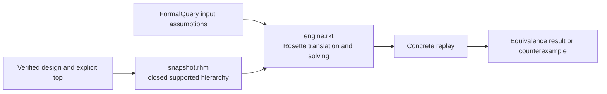

<!-- Explains how to extend and validate Rhodium's Rosette-backed formal engine. -->
<!-- SPDX-License-Identifier: Apache-2.0 -->

# Developing the formal engine

Read the formal [README](README.md) for the public queries, assumptions, result
statuses, supported semantics, and fail-closed limits. This guide owns the
implementation and coverage workflow.

## Architecture and ownership

The formal engine is an optional consumer of verified public IR. It validates
the complete hierarchy, snapshots the supported structure, translates packed
values and operations into Rosette bitvectors, solves the requested query, and
replays any model concretely before returning it.



[`main.rhm`](main.rhm) owns the public Rhombus API and result construction.
[`snapshot.rhm`](snapshot.rhm) owns backend-independent traversal and immutable
input to the RTL solver boundary. [`engine.rkt`](engine.rkt) interprets only RTL;
the symbolic spec interpreter consumes a separate format. Core, frontend, and backend packages must not import
the formal engine.

The independent [spec.rhm](spec.rhm) owns typed expression construction,
reference validation and rspecsim, the concrete single-edge interpreter. It does not import
the hardware graph or the solver. Keep new operators as typed data with
defined behavior on partial inputs, not callbacks that a symbolic interpreter
would have to reverse-engineer. The [FIFO example](../../examples/formal/shift-queue.rspl)
is a client, not a privileged opcode.

[The RSPECL reader and language profile](../../rspecl/language.rhm) expose
[spec-dsl.rhm](spec-dsl.rhm) to `.rspl` authors without loading Rosette.
The profile handles `spec for` in two Rhombus contexts: a module declaration
exports the generated constructor, while a local definition only binds it.
Both expand through the same constructor builder; ordinary helpers retain
Rhombus export rules.
For `spec for rtl.Name`, both circuit forms use the declaration's namespace to supply
scalar input, interface, indexed interface, and non-private parameter names at expansion time. RSPECL
introduces lexical bindings in the spec's scope; model construction checks
the actual top's family identity before reading its ports or configuration.
Parameter references read only the retained integer or Boolean values, so
an unused type descriptor or function never enters the model.
[The RTL boundary adapter](../../rspecl/rtl-boundary.rhm) projects each
interface direction record into logical member names. Only input members
can build expressions; output members are observation targets. The leaf proofs
pack and unpack the actual library ports in declared record order. Explicit `ignore` excludes
an output from the leaf guarantee, never from the RTL itself.
The frontend does not import RSPECL, and the spec body is not scanned for
unbound names. The profile neither elaborates a second module nor passes one
into the behavioral model. [port-types.rhm](port-types.rhm) checks observation
names and sorts. All sampled data inputs remain in the schema, even unused ones.
The DSL collects named declarations and rejects duplicate fields before assembling
the maps. Emit each right-hand side at its original lexical site: a later
`let` must not change an earlier output. Rhombus expands expressions,
operators and helper calls, including imported bindings. Only their resulting
typed IR crosses the interpreter boundary. The [surface tests](tests/spec-dsl-test.rspl)
exercise a separately imported helper, lexical shadowing, host short-circuiting
and partial sequence reads; the proof bindings use the same model unchanged.

### Symbolic specification step

`spec_snapshot(model)` copies the checked input/state schemas, typed expressions,
care predicates, input assumptions and updates. The internal [spec-engine.rkt](spec-engine.rkt)
entry point `symbolic-spec-edge` consumes that snapshot and returns one edge
from fresh pre-edge state and input terms, **not** a run from `model.initial`.
Its `legal` predicate excludes out-of-range sequence counts only. Use
`spec-input-assumptions` separately: the same predicates are premises at a
conditional leaf and proof obligations at its parent. Sequences
use a bitvector count and fixed scalar slots; only the live prefix is meaningful.
The result has separate output/event maps of (care, value) and simultaneous
next-state terms. Compare presence first and payload only when present.

The separate `defined` predicate covers every executed partial operation,
including reads in care predicates. Inactive operands of a conditional or
short-circuit conjunction incur no obligations. Do not assume `defined`:
ask whether any legal edge violates it before comparing values. For the FIFO,
`tests/spec-symbolic-test.rhm` calls the concrete step for every legal row;
the solver checks coverage, definedness and disagreement over arbitrary padding.

### Register-transition foundation

The internal engine API `prepare_transition_snapshot(snapshot, clock)` lowers a
verified single-clock hierarchy once. It expands each register occurrence into
a synthetic current-state input and next-state output of a combinational
snapshot; the existing packed interpreter owns all arithmetic and aggregate
semantics. Resolve instance ports lazily by value, not by eagerly evaluating all
child inputs: feedback through a child register must not become a false
combinational cycle. Retain outputless instances, unused partial operations,
and occurrence/source diagnostics. Unsupported operations fail before lowering.

`transition_registers(plan)` returns deterministic descriptors keyed by
`Top.instance.register`. `symbolic_transition_state(plan)` creates independent,
unconstrained bitvectors for every register, including resettable registers;
`symbolic_transition_inputs(plan)` creates fresh data/reset samples, excluding
the selected clock. These are internal solver objects, not authoring values.

`step_transition(plan, state, inputs)` requires complete, exact-name assignments
with packed naturals or exact-width bitvectors. It returns pre-edge outputs and
a separate simultaneous next-state map, without mutating the plan or prior
state. Reset selects the reset value only on that sampled edge. There is no
implicit initialization, reset prefix, input forcing, or clock waveform: one
call means one rising edge of the explicitly selected top-level Clock. Only
structural clock aliases are admitted.

The step also returns obligations for partial operations and clocked assertions,
including in outputless children. Each assertion must use the selected clock;
it samples `!guard || reset || condition` before register updates, even when
only its successor state would satisfy the condition. The obligation carries
the label and original occurrence diagnostic; a false assertion is returned,
not assumed. `transition_step_validity(step)` conjoins all obligations; it is
**not a proof**. Concrete invalid operation domains are rejected. The public
combinational query API retains its existing restrictions.

### ShiftQueue refinement by depth

The shared [run-local checker](refinement.rkt) takes a completed definition,
its executable spec, the interface naming function, and an independent
observer. It snapshots the definition and spec itself. A clockless leaf is
checked over every input sample allowed by its spec. For a single rising clock and active-high
sampled reset, supply a state relation, not a premise: the checker builds the
reset and preservation domains and requires them to be feasible. Reset starts
with unconstrained RTL state and must establish both the declared spec start
and the relation. Both phases discharge RTL obligations, spec definedness,
cared physical outputs and event agreement. Callers own the interpretation of
care and transfer events and the abstraction relation. Only input assumptions
in the matched leaf contract can restrict external traffic. A counterexample, unknown, or ambient constraint
cannot mint a result.

[The leaf proof](tests/shift-queue-induction.rkt) uses one symbolic input sample
for the RTL and the executable spec, but allocates their old states independently.
For spec length `n <= depth`, RTL slot `i` must be occupied exactly when `i < n`;
only then must its two-bit payload equal spec item `i`. Slot zero is the head.

The [proof inventory](tests/composition-binding.rhm) elaborates depths 1, 2,
and 3 together; each leaf proof starts from the exact FIFO definition found
in its parent's wiring. Each occupancy from empty through full must be feasible.
On the first sampled reset, the RTL state is unrestricted, including holes
where the depth permits them. The solver checks that the successor represents the declared empty
spec start. The same reset proof covers later resets. The non-reset induction
step assumes only a legal related old state; FIFO traffic is unrestricted. Separate queries establish RTL
assertions and operation domains, spec definedness, cycle observations, the
joint event, and the successor relation. Care must match even when the value
is absent, and a valid head is observed even under backpressure. Count and mask
ports are not part of the exported view.

[`derive-fifo-transactions`](refinement.rkt) weakens the issued cycle evidence
without reopening child RTL. It matches the exact definition and physical
member layout, requires an unconditional clocked result, and takes the capacity
and payload type from the named sequence in the certified spec. It steps that
snapshot on an arbitrary legal old state and input, not its concrete initial
state. Uncared outputs are fresh physical values; the sampler must agree with
the FIFO monitor for all of them. Reset and preservation are separate
obligations on the projected live sequence. The [leaf transaction regression](tests/shift-queue-transactions.rkt)
applies the same retirement invariant at each depth. A separate coverage query
asks whether the tracked word can stall behind an older word: UNSAT at depth
one and SAT at depths two and three. Neither answer restricts the theorem.
The direct series checker can use these results at grouped child boundaries.

Run `moon run rhodium:formal-test` to reproduce the proof. A failed induction
query alone is not a trace from reset. For the faulty leaf, the test obtains a
SAT payload mismatch at a singleton, reaches that queue with a real enqueue,
and replays the solver's final input through RTL and rspecsim. It checks the
first differing observation and that the same trace passes on the correct leaf.

### Two ShiftQueues in series

[QueuePair](tests/shift-queue-fixture.rhdl) instantiates the same verified leaf
definition twice. The [composition binding](tests/composition-binding.rhm) reads the
parent's ports, drivers, and instance signatures, not its children's bodies.
The leaf proof runs once on the shared definition and releases its exact spec
only after the initialization, preservation, and feasibility checks pass.
Both occurrences admit the same leaf result. There is no persistent certificate.
The [parent proof](tests/shift-queue-pair.rkt)
steps the extracted wiring, including the common clock/reset, and allocates just
`a.q` and `b.q`. Evidence for the wrong depth or a consumer of a hidden
port such as `mask` does not qualify.

The spec engine resolves pre-edge offers from each child's old state and reset
before binding the handshake inputs. A missing input dependency is an error,
not a wire equality assumed to have a solution. Uncared wires get arbitrary
values. Both child input domains and definedness must hold under the parent
invariant for every external sample; no child assumption may restrict the proof.

The external transaction sequence is the live contents of B followed by A.
Reset empties it; otherwise an external dequeue removes its oldest word and
an enqueue appends the offered word. A middle handshake agrees at both ends
and does not by itself change this sequence. The solver checks length and each
live successor position, including simultaneous external transfers. Reset/fill/drain
traces attain capacities two and four at child depths one and two. Run
`moon run rhodium:formal-test` to reproduce the proofs.

[FIFO transaction certification](refinement.rkt) takes a [bound view](tests/queue-pair.rspl),
not two hand-written endpoint lists. RSPECL checks the declaration's circuit
family; the [view binder](fifo-view.rhm) checks the actual module's port names,
directions, sorts, and clock/reset. It builds a stateless spec-IR sampler over
both inputs and outputs. The cut must match that exact module. The caller projects the old and new
cut states into pending words; reset and preservation must prove the same
`fifo-allows?` relation that downstream clients consume. Certification also
discharges child definedness and legality. A successful result retains the
definition, endpoint mapping, width, and capacity bound, not a steppable cut.
It cannot serve as cycle evidence for `prepare-proved-wiring`. The
[FIFO monitor](fifo-monitor.rhm) defines the relation once in typed spec IR.
rspecsim returns the concrete live words on an allowed batch; certification
and consumers interpret the same IR with Rosette. The adapter rejects invalid
mathematical counts before they can wrap, ignores the predecessor count on
reset, and compares only live successor slots.

The [event-only consumer](tests/queue-pair-transaction-order.rkt) tracks an
arbitrary acceptance ordinal and its word. Its induction ranges over **all**
joint events allowed by the exported relation, including stutter and simultaneous
accept/retire. It imports neither child model. From reset and one acceptance,
both refusal and admission of a second offer are consistent with the contract;
only the concrete implementation determines which occurs on that edge.

`compose-fifo-series` admits a narrower wiring-only parent using **only** two
transaction results. It matches the actual child definitions, all three
valid/ready/data connections (ingress, handoff, egress), and each clock/reset
driver. The parent interface is scalar and the cut allows no local behavior.
For each child occurrence, the checker obtains the certified physical-port
layout only after matching the exact definition. It follows RTL record creation
and field selection in the parent to identify the actual driver of every sink.
The [grouped QueuePair proof](tests/queue-pair-grouped.rkt) uses two independent
transaction histories, even though both sites reuse the same ShiftQueue evidence.
It needs neither child cycle state nor RTL registers. An independent ready
driver, external data substituted at the handoff, or routing the hidden mask
as head data is rejected before sharing any symbolic pins. After that check,
three unconstrained (valid, ready, payload) triples represent the two external
links and the handoff. The checker interprets both child samplers and the
parent sampler on those links and proves they are defined for every sample.
It ranges over all successors allowed by both child relations, without using
any cycle timing guarantee. It proves the joint external FIFO rule on the downstream
pending words followed by the upstream words; only the internal transfer is hidden.
The [series regression](tests/queue-pair-series.rkt) composes the two grouped-proof
results again and feeds the resulting six-word contract to the original ordering
observer. Its separate full-RTL replay runs the same declared parent sampler in
rspecsim and sends the resulting
batches to the concrete monitor, including refusal on
the second offer and a six-word fill/drain. Corrupting the first retirement
after the same prefix is rejected. The trace is not a proof premise. A separate
symbolic regression checks both directions against the previous arithmetic
relation at capacities two, four, and six, including arbitrary slot padding.

The [depth-one replay](tests/queue-pair-trace.rhm) steps rspecsim on the extracted
wiring and sends the same eight input samples and cared pre-edge observations to
the [native RTL driver](tests/queue-pair-replay.cpp). It checks refusal during
an internal handoff, successful retry, and ordered drain. This replay runs in
`moon run rhodium:formal-differential-test`; the parent proof never expands child RTL.

### Two-input fixed-priority arbiter

[The arbiter proof](tests/arbiter-refinement.rkt) compares the clockless Flow circuit
`Arbiter(Bits(2), 2)` with its [stateless spec](../../examples/formal/arbiter.rspl).
`combinational_sample(snapshot, pins)` accepts exact-name, exact-width
bitvectors or fitting naturals and returns outputs and partial-operation
obligations, including those in child instances. Combinational preflight
rejects state. Prove these obligations even on idle samples; the proof never
assumes mutually exclusive requests or that the output is ready.

Both input ready signals and output valid are always observed. Data and chosen
index are observed whenever valid, including under backpressure. Events are
actual handshakes; exactly one input supplies each output transfer, and stalls
consume neither input. The negative fixture swaps the physical priority lanes
and maps grants back to external lane identities. The solver's contested
transfer replays as opposite winners and payloads in concrete RTL and rspecsim.
The proof is part of `moon run rhodium:formal-test`.

### Discharging a conditional child's inputs

The [selector regression](tests/selector-refinement.rkt) proves the leaf on
the nonempty conjunction of its named input predicates. The predicates are part
of the exact spec snapshot matched at reuse. After evidence matching but before
returning an admitted cut, `prepare-proved-wiring` checks each predicate as
a goal over unrestricted external samples and independently legal old states.
The discharge pass follows each predicate's input references through the checked
wiring. Reading an offer first requires its source occurrence's whole contract,
then the inputs used in both its care and value. Cache each physical offer for
the sample, including an arbitrary uncared value shared by all fanout.
The solver must establish upstream definedness and every named predicate
before that occurrence becomes available. Revisiting an in-progress contract
is a same-edge proof cycle, not a counterexample on external inputs. Even two
instances of the same verified leaf must discharge their premises independently.

The routed example discharges the router using verified arbiter grants, then
the selector using the router's outputs. Duplicating a routed grant fails
at `lanes/exclusive`; replay the returned external sample on both wirings.
The complete parent proof still checks all outputs and child transitions, not
just the cones used during discharge.

For a clocked leaf, conjoin the same current-input predicates with both phase
domains. Reset must be feasible and establish the relation without assuming
it; preservation must be feasible from a related state with reset *deasserted*.
Putting reset in the guard is an author decision, not an implicit exemption.
The registered selector regression removes the guard to expose a bad successor
and tries reset-only and non-reset-only guards to check phase non-vacuity.
At the parent cut, the relation mentions the stored word in the child's spec,
never its RTL register. The duplicated-grant witness replays after a sampled
reset, and changing only its reset bit makes the same enables legal.

For a composite block with an input contract, pass the raw `proof_cut` and
`#:child-evidence` to `prove-parent`. After matching signatures and evidence,
the checker evaluates the parent snapshot's named predicates on each query's
external inputs. They are premises for ordered child discharge and for the
parent's reset and preservation obligations. This path returns only refinement
evidence bound to the full parent snapshot, never a separately steppable cut.
`prepare-proved-wiring` still admits children only on unrestricted external
inputs. On reuse, the outer proof must match and discharge the parent's exact
contract at the occurrence before using its outputs.

The GatedCapture regression uses only registered-selector evidence inside the
wrapper, then only arbiter and wrapper evidence outside it. Removing the
wrapper premise fails the inner child check; substituting a premise-free
wrapper spec with the original evidence fails matching. The raw-request
fixture reports `gate/capture_exclusive` on the bad edge and replays the same
two requests with capture disabled and with reset asserted.

### Arbiter feeding a ShiftQueue

The [example RTL](../../examples/formal/arbiter-queue.rhdl) owns the wiring and port
signature. Payload width specializes both leaves. The parent's requested
depth is retained automatically and forwarded to the FIFO. The
spec reads that parent constant at construction, not child metadata or state.
The proof binds the external contract to the same elaborated top used for substitution.
The [bridge](wiring.rhm) reads the parent operations and child signatures,
then substitutes models by exact child definition. The fixture identifies the
arbiter and FIFO sites by their circuit declarations, not generated names. It follows direct scalar
wires and directional interface records, including
indexed lanes. Record creation and selection route individual members. The
concrete wiring bridge stops there; proof cuts also support the local RTL
fragment described below. A child clock must connect directly to
the parent clock. The cut uses the same logical member names as the leaf spec.
Unused unmodeled outputs (count/mask)
are allowed; a parent consuming one is rejected. The bridge constructs a
graph, not a proof certificate. For symbolic substitution, `proof_cut` keeps
the actual occurrence definitions and sampled layouts alongside the graph.
`prepare-proved-wiring` compares them and the complete spec snapshots against
opaque successful refinement results, before any parent solver query. The admitted
plan supplies the models to `proved-edge-at`; no child registers are expanded
and no new models may be passed at step time. This check does not discharge
the parent's own obligations. For reusable evidence, clocked children must
sample the parent clock and reset directly. Both executors settle each output once from
its old-state care/value dependencies; all child updates see the same edge.
An uncared internal pin is false/zero in concrete replay and fresh per
source in Rosette, never a guaranteed payload.

The [ordering proof](tests/arbiter-queue-order.rkt) steps the
[external contract](../../examples/formal/arbiter-queue.rspl) independently of
the composition. At each depth it substitutes the FIFO proved in that run and
the shared stateless arbiter. The history and abstract FIFO must fit the
declared capacity and agree on length and live words, not padding. A one-slot
FIFO cannot admit while retiring; the larger specializations must exhibit
such an edge. Prove reset from unrelated legal states, then check cared
output pins, externally decoded transfer events, and successor agreement.
Both [faulty parents](tests/arbiter-queue-fixture.rhdl) have the same interface as
the correct parent but are separate circuit declarations. Always build the reference
contract from the correct parent at the requested depth. At each depth the wrong-lane
fixture acknowledges the winning lane but routes lane one's payload to the FIFO;
reset, contest, and drain expose the error. The undersized fixture instantiates
a one-entry FIFO. After reset and two offers without a dequeue, its real RTL
rejects the second word, while the depth-two contract and correct RTL accept. This replay does not substitute
the depth-two certificate for the smaller child.

`prove-parent` uses the admitted cut's actual parent identity and sampled
layout. It quantifies over independent child spec states and external inputs;
from reset it establishes the reference start and relation, then checks that
every related edge agrees on cared pins and transfers and preserves the
relation. A failed or unknown obligation returns no evidence. The wrong-lane
fixture fails preservation even though both of its child results are valid.

The [nested ordering proof](tests/buffered-arbiter-queue-order.rkt) admits
only that ArbiterQueue result and a one-slot ShiftQueue result. Its ordered
backlog is the tail's live words followed by the front's pending winners.
It proves head retirement, suffix retention, winner append, and occupancy
conservation, and exercises a reachable fill/stall/drain trace for each front
depth.

### Parent-local RTL with an opaque child

The [local lowering](parent-local.rhm) reads operations from the completed
parent, not a second model supplied by the proof author. It adds one reserved
`@local` graph participant for packed constants and comparisons, casts
between Bool and Bits(1), Boolean NOT/AND/OR, binary muxes on Boolean or packed data, synchronously reset Boolean registers,
and directly clocked packed registers without reset. The current register is an old-state output; its actual driver
and reset value determine the successor. Local taps and child outputs use
the same per-output dependency schedule, including fresh values on uncared
pins. Each real instance still requires matching refinement evidence.
Unsupported operations or non-direct clock/reset domains are rejected.

The [gated proof](tests/gated-arbiter-queue-order.rkt) relates exactly one
parent register and the verified queue's pending sequence to the wrapper's
independent admission and history spec. Check reset and preservation at depths
1–3. The leaky fixture fails preservation; a separate full-RTL replay shows
an unacknowledged word retiring. That replay is not an input to certification.

The [two-tag ROB proof](tests/two-tag-rob-proof.rkt) relates four parent
busy/done bits, two per-tag generation bits, two unreset payload banks, and the queue's live tag words to
an issue history and the first result of each completed tag. The proof starts
the banks symbolically and relates their contents only while their tags are
complete; the local model's concrete simulation seed is not a reset assumption.
For each tag the RTL advances its bit at retirement, the reference at issue:
their bits are opposite while live and equal while idle. Require canonical tag encoding, uniqueness in the live
prefix, exact busy membership, and no completed idle tag. The reset case
starts from unrelated states; the preservation case assumes no traffic
restrictions. The “either done” mutant must fail induction and retire A early
on an actual reset/issue A/issue B/complete B/drain trace. The swapped-bank
mutant passes the tag-only projection but fails on cared outputs. A separate
stall lemma checks adjacent samples with unrestricted next inputs; full RTL
replays exercise duplicate completions while A is stalled. For each lane, check
that only its grant advances its next token and that a wrong-generation pulse
has the same effect as no pulse, leaving the other lane's traffic unrestricted.
The ignore-generation mutant must fail preservation and retire stale A0 data
during A1. A second reuse shows why the alternating bit cannot protect A2 from A0.

The independent [rspecsim oracle](tests/two-tag-rob-test.rhm) records integer
allocation serials on entries and compares their low bits only at the interface.
It exercises all 61 tag/data states against 64 control samples with representative
payloads and generations, plus an independent generation/echo matrix with both
tags pending (4,928 concrete cases total). Induction uses unrestricted inputs.
Run `moon run rhodium:formal-spec-test rhodium:formal-test`.

## Extend supported semantics

1. Define the public meaning and failure boundary in [README.md](README.md).
2. Extend preflight and snapshot coverage so unsupported reachable structure
   fails before a success claim.
3. Add the bitvector interpretation in the engine. Preserve canonical record
   and vector packing, unequal shift-width behavior, hierarchy, and strict type
   equality.
4. If the operation has a partial-domain contract, add an explicit proof
   obligation like the existing exactly-one requirement for `rtl.onehot_mux`.
   Never choose a value for unspecified behavior.
5. Replay witnesses and counterexamples through the concrete interpreter before
   returning them.
6. Add focused valid, counterexample, unsupported, invalid-argument, and vacuous
   coverage as applicable.

Outside the internal register-transition path, sequential state remains unsupported.
Only ordinary clocked assertions have transition semantics among verification effects.
Memories, DPI, partial values, and new operations
remain unsupported until each receives an explicit semantic model. Do not
silently ignore a reachable operation or restrict the query to one convenient
backward slice.

Unsigned `rtl.urem` uses `bvurem` only after proving its divisor nonzero under
the complete query. Collect this obligation even for an unused result or a child
instance, as for one-hot selection; SMT's total zero-divisor interpretation is
not a definition of unspecified RTL behavior. Concrete replay rejects zero.
`tests/remainder-test.rhm` covers equivalence against a lookup oracle,
counterexample replay, unproved and unused-operation domains, and vacuity.

## Change queries or results

Keep assumptions as explicit packed constraints over named top inputs. Validate
ports, types, widths, masks, and satisfiability before evaluating a query.
Result statuses must distinguish proved facts, counterexamples, vacuity,
unsupported semantics, and solver uncertainty. Invalid API arguments remain
errors rather than formal statuses.

Every counterexample must contain complete, nonnegative input assignments and
concrete differences at the paired outputs.

## Validation

For changes to rspecsim, run `moon run rhodium:formal-spec-test`.
This host-only target enumerates all 21 legal contents and all 32 input samples
of a depth-two, two-bit FIFO, checks observations and state against a list
oracle, and exercises invalid models and simultaneous state updates.

The solver-backed suite includes [the leaf replay](tests/shift-queue-replay.rkt).
The binding instantiates a real two-bit, depth-two ShiftQueue, with pipe, flow
and flush disabled. It samples the handshakes at the ports and independently
relates the compact occupied prefix of payload registers to the spec list.
Unused slots are ignored. Count and mask are additional replay diagnostics,
not part of the exported observation view. Each tested trace begins at an
explicit reset. A failing trace retains startup bits, all input samples through
the first mismatch, and expected and actual values. This is not an induction result.

Run the solver-backed API and semantic suite:

```sh
moon run rhodium:formal-test
```

When operation interpretation, packing, replay, or assumptions change, also run
the independent CIRCT/Verilator differential check:

```sh
moon run rhodium:formal-differential-test
```

The differential test exercises all 128 reduced-width unequal-shift inputs, 80
aggregate layouts and projections, 256 hierarchical arithmetic inputs, eight
decode selectors, and 12,288 valid one-hot selections against independent
SystemVerilog oracles.

The formal target performs a live Rosette/Z3 probe under an isolated compiled
root. State the actual solver and external-tool coverage run; an import-only
probe is not equivalent to solving or differential replay.

`tests/transition-test.rhm` applies concrete recurrence oracles and solver checks
to snapshots built with the public Builder: counter wrap/reset, pre-update
sampling, resetless pipelines, packed vector state, repeated child registers,
hierarchical feedback, outputless state, explicit initial-state validation, and
partial-operation obligations. It is included in `moon run rhodium:formal-test`.
`tests/run-transition.py --circt` compares a defined pre-edge trace with an
independent Python recurrence, native rsim under sanitizers, direct SV, and
CIRCT SV. It runs in `moon run rhodium:formal-differential-test`; undefined startup values
are not compared, and uninitialized unrelated feedback state is not treated as
portable zero. All generated artifacts are temporary.
