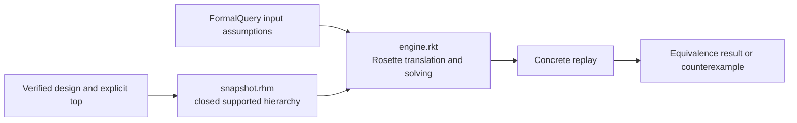

<!-- Explains how to extend and validate Rhodium's Rosette-backed formal engine. -->
<!-- SPDX-License-Identifier: Apache-2.0 -->

# Developing the formal engine

Read the formal [README](README.md) for the public queries, assumptions, result
statuses, supported semantics, and fail-closed limits. This guide owns the
implementation and coverage workflow.

## Architecture and ownership

The formal engine is an optional consumer of verified public IR. It validates
the complete hierarchy, snapshots the supported structure, translates packed
values and operations into Rosette bitvectors, solves the requested query, and
replays any model concretely before returning it.



[`main.rhm`](main.rhm) owns the public Rhombus API and result construction.
[`snapshot.rhm`](snapshot.rhm) owns backend-independent traversal and immutable
input to the solver boundary. [`engine.rkt`](engine.rkt) is the sole production Rosette
interoperability module. Core, frontend, and backend packages must not import
the formal engine.

### Register-transition foundation

The internal engine API `prepare_transition_snapshot(snapshot, clock)` lowers a
verified single-clock hierarchy once. It expands each register occurrence into
a synthetic current-state input and next-state output of a combinational
snapshot; the existing packed interpreter owns all arithmetic and aggregate
semantics. Resolve instance ports lazily by value, not by eagerly evaluating all
child inputs: feedback through a child register must not become a false
combinational cycle. Retain outputless instances, unused partial operations,
and occurrence/source diagnostics. Unsupported operations fail before lowering.

`transition_registers(plan)` returns deterministic descriptors keyed by
`Top.instance.register`. `symbolic_transition_state(plan)` creates independent,
unconstrained bitvectors for every register, including resettable registers;
`symbolic_transition_inputs(plan)` creates fresh data/reset samples, excluding
the selected clock. These are internal solver objects, not authoring values.

`step_transition(plan, state, inputs)` requires complete, exact-name assignments
with packed naturals or exact-width bitvectors. It returns pre-edge outputs and
a separate simultaneous next-state map, without mutating the plan or prior
state. Reset selects the reset value only on that sampled edge. There is no
implicit initialization, reset prefix, input forcing, or clock waveform: one
call means one rising edge of the explicitly selected top-level Clock. Only
structural clock aliases are admitted.

The step also returns domain obligations for partial operations, including
unused operations in outputless children. `transition_step_validity(step)` is
their conjunction, **not a proof**. Concrete invalid domains are rejected. The
public combinational query API retains its existing restrictions.

## Extend supported semantics

1. Define the public meaning and failure boundary in [README.md](README.md).
2. Extend preflight and snapshot coverage so unsupported reachable structure
   fails before a success claim.
3. Add the bitvector interpretation in the engine. Preserve canonical record
   and vector packing, unequal shift-width behavior, hierarchy, and strict type
   equality.
4. If the operation has a partial-domain contract, add an explicit proof
   obligation like the existing exactly-one requirement for `rtl.onehot_mux`.
   Never choose a value for unspecified behavior.
5. Replay witnesses and counterexamples through the concrete interpreter before
   returning them.
6. Add focused valid, counterexample, unsupported, invalid-argument, and vacuous
   coverage as applicable.

Outside the internal register-transition path, sequential state remains unsupported.
The stepper rejects verification effects, including ordinary RTL assertions.
Memories, DPI, partial values, and new operations
remain unsupported until each receives an explicit semantic model. Do not
silently ignore a reachable operation or restrict the query to one convenient
backward slice.

Unsigned `rtl.urem` uses `bvurem` only after proving its divisor nonzero under
the complete query. Collect this obligation even for an unused result or a child
instance, as for one-hot selection; SMT's total zero-divisor interpretation is
not a definition of unspecified RTL behavior. Concrete replay rejects zero.
`tests/remainder-test.rhm` covers equivalence against a lookup oracle,
counterexample replay, unproved and unused-operation domains, and vacuity.

## Change queries or results

Keep assumptions as explicit packed constraints over named top inputs. Validate
ports, types, widths, masks, and satisfiability before evaluating a query.
Result statuses must distinguish proved facts, counterexamples, vacuity,
unsupported semantics, and solver uncertainty. Invalid API arguments remain
errors rather than formal statuses.

Every counterexample must contain complete, nonnegative input assignments and
concrete differences at the paired outputs.

## Validation

Run the solver-backed API and semantic suite:

```sh
moon run rhodium:formal-test
```

When operation interpretation, packing, replay, or assumptions change, also run
the independent CIRCT/Verilator differential check:

```sh
moon run rhodium:formal-differential-test
```

The differential test exercises all 128 reduced-width unequal-shift inputs, 80
aggregate layouts and projections, 256 hierarchical arithmetic inputs, eight
decode selectors, and 12,288 valid one-hot selections against independent
SystemVerilog oracles.

The formal target performs a live Rosette/Z3 probe under an isolated compiled
root. State the actual solver and external-tool coverage run; an import-only
probe is not equivalent to solving or differential replay.

`tests/transition-test.rhm` applies concrete recurrence oracles and solver checks
to snapshots built with the public Builder: counter wrap/reset, pre-update
sampling, resetless pipelines, packed vector state, repeated child registers,
hierarchical feedback, outputless state, explicit initial-state validation, and
partial-operation obligations. It is included in `moon run rhodium:formal-test`.
`tests/run-transition.py --circt` compares a defined pre-edge trace with an
independent Python recurrence, native rsim under sanitizers, direct SV, and
CIRCT SV. It runs in `moon run rhodium:formal-differential-test`; undefined startup values
are not compared, and uninitialized unrelated feedback state is not treated as
portable zero. All generated artifacts are temporary.
