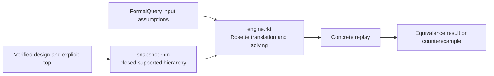

<!-- Explains how to extend and validate Rhodium's Rosette-backed formal engine. -->
<!-- SPDX-License-Identifier: Apache-2.0 -->

# Developing the formal engine

Read the formal [README](README.md) for the public queries, assumptions, result
statuses, supported semantics, and fail-closed limits. This guide owns the
implementation and coverage workflow.

## Architecture and ownership

The formal engine is an optional consumer of verified public IR. It validates
the complete hierarchy, snapshots the supported structure, translates packed
values and operations into Rosette bitvectors, solves the requested query, and
replays any model concretely before returning it.



[`main.rhm`](main.rhm) owns the public Rhombus API and result construction.
[`snapshot.rhm`](snapshot.rhm) owns backend-independent traversal and immutable
input to the RTL solver boundary. [`engine.rkt`](engine.rkt) interprets only RTL;
the symbolic spec interpreter consumes a separate format. Core, frontend, and backend packages must not import
the formal engine.

The independent [spec.rhm](spec.rhm) owns typed expression construction,
reference validation and rspecsim, the concrete single-edge interpreter. It does not import
the hardware graph or the solver. Keep new operators as typed data with
defined behavior on partial inputs, not callbacks that a symbolic interpreter
would have to reverse-engineer. The [FIFO example](../../examples/formal/shift-queue.rspl)
is a client, not a privileged opcode.

[The RSPECL reader and language profile](../../rspecl/language.rhm) expose
[spec-dsl.rhm](spec-dsl.rhm) to `.rspl` authors without loading the RTL or
Rosette engines. Named declarations lower to the anonymous `spec:` expression;
parameterized declarations use ordinary Rhombus function parameters. Keep one
implementation of the model body for both forms.
It collects named declarations and rejects duplicate fields before assembling
the maps. Emit each right-hand side at its original lexical site: a later
`let` must not change an earlier output. Rhombus expands expressions,
operators and helper calls, including imported bindings. Only their resulting
typed IR crosses the interpreter boundary. The [surface tests](tests/spec-dsl-test.rspl)
exercise a separately imported helper, lexical shadowing, host short-circuiting
and partial sequence reads; the proof bindings use the same model unchanged.

### Symbolic specification step

`spec_snapshot(model)` copies the checked input/state schemas, typed expressions,
care predicates and updates. The internal [spec-engine.rkt](spec-engine.rkt)
entry point `symbolic-spec-edge` consumes that snapshot and returns one edge
from fresh pre-edge state and input terms, **not** a run from `model.initial`.
Its `legal` predicate excludes out-of-range sequence counts only. Sequences
use a bitvector count and fixed scalar slots; only the live prefix is meaningful.
The result has separate output/event maps of (care, value) and simultaneous
next-state terms. Compare presence first and payload only when present.

The separate `defined` predicate covers every executed partial operation,
including reads in care predicates. Inactive operands of a conditional or
short-circuit conjunction incur no obligations. Do not assume `defined`:
ask whether any legal edge violates it before comparing values. For the FIFO,
`tests/spec-symbolic-test.rhm` calls the concrete step for every legal row;
the solver checks coverage, definedness and disagreement over arbitrary padding.

### Register-transition foundation

The internal engine API `prepare_transition_snapshot(snapshot, clock)` lowers a
verified single-clock hierarchy once. It expands each register occurrence into
a synthetic current-state input and next-state output of a combinational
snapshot; the existing packed interpreter owns all arithmetic and aggregate
semantics. Resolve instance ports lazily by value, not by eagerly evaluating all
child inputs: feedback through a child register must not become a false
combinational cycle. Retain outputless instances, unused partial operations,
and occurrence/source diagnostics. Unsupported operations fail before lowering.

`transition_registers(plan)` returns deterministic descriptors keyed by
`Top.instance.register`. `symbolic_transition_state(plan)` creates independent,
unconstrained bitvectors for every register, including resettable registers;
`symbolic_transition_inputs(plan)` creates fresh data/reset samples, excluding
the selected clock. These are internal solver objects, not authoring values.

`step_transition(plan, state, inputs)` requires complete, exact-name assignments
with packed naturals or exact-width bitvectors. It returns pre-edge outputs and
a separate simultaneous next-state map, without mutating the plan or prior
state. Reset selects the reset value only on that sampled edge. There is no
implicit initialization, reset prefix, input forcing, or clock waveform: one
call means one rising edge of the explicitly selected top-level Clock. Only
structural clock aliases are admitted.

The step also returns obligations for partial operations and clocked assertions,
including in outputless children. Each assertion must use the selected clock;
it samples `!guard || reset || condition` before register updates, even when
only its successor state would satisfy the condition. The obligation carries
the label and original occurrence diagnostic; a false assertion is returned,
not assumed. `transition_step_validity(step)` conjoins all obligations; it is
**not a proof**. Concrete invalid operation domains are rejected. The public
combinational query API retains its existing restrictions.

### Fixed ShiftQueue refinement

[The leaf proof](tests/shift-queue-induction.rkt) uses one symbolic input sample
for the RTL and the executable spec, but allocates their old states independently.
For spec length `n <= 2`, RTL slot `i` must be occupied exactly when `i < n`;
only then must its two-bit payload equal spec item `i`. Slot zero is the head.

On the first sampled reset, the RTL state is unrestricted, including occupancy
mask `10`. The solver checks that the successor represents the declared empty
spec start. The induction step assumes only a legal related old state; inputs,
including subsequent resets, are unrestricted. Separate queries establish RTL
assertions and operation domains, spec definedness, cycle observations, the
joint event, and the successor relation. Care must match even when the value
is absent, and a valid head is observed even under backpressure. Count and mask
ports are not part of the exported view.

Run `moon run rhodium:formal-test` to reproduce the proof. A failed induction
query alone is not a trace from reset. For the faulty leaf, the test obtains a
SAT payload mismatch at a singleton, reaches that queue with a real enqueue,
and replays the solver's final input through RTL and rspecsim. It checks the
first differing observation and that the same trace passes on the correct leaf.

### Two ShiftQueues in series

[QueuePair](tests/shift-queue-fixture.rhdl) instantiates the same verified leaf
definition twice. The [composition binding](tests/composition-binding.rhm) reads the
parent's ports, drivers, and instance signatures, not its children's bodies.
The leaf proof runs once on the shared definition and releases its exact spec
only after the initialization, preservation, and feasibility checks pass.
There is no persistent certificate. The [parent proof](tests/shift-queue-pair.rkt)
checks the direct netlist, including the common clock/reset, and allocates just
`a.q` and `b.q`. A changed topology or a consumer of a hidden port such as
`mask` does not qualify.

The spec engine resolves pre-edge offers from each child's old state and reset
before binding the handshake inputs. A missing input dependency is an error,
not a wire equality assumed to have a solution. Uncared wires get arbitrary
values. Both child input domains and definedness must hold under the parent
invariant for every external sample; no child assumption may restrict the proof.

The external transaction sequence is the live contents of B followed by A.
Reset empties it; otherwise an external dequeue removes its oldest word and
an enqueue appends the offered word. A middle handshake agrees at both ends
and does not by itself change this sequence. The solver checks length and each
live successor position, including simultaneous transfers. A reset/fill/drain
trace attains capacity four. Another edge has one free slot but no input
admission. The depth-one readiness example uses specs only, not depth-two RTL
evidence. Run `moon run rhodium:formal-test` to reproduce these checks.

### Two-input fixed-priority arbiter

[The arbiter proof](tests/arbiter-refinement.rkt) compares a clockless wrapper
of `Arbiter(Bits(2), 2)` with its [stateless spec](../../examples/formal/arbiter.rspl).
`combinational_sample(snapshot, pins)` accepts exact-name, exact-width
bitvectors or fitting naturals and returns outputs and partial-operation
obligations, including those in child instances. Combinational preflight
rejects state. Prove these obligations even on idle samples; the proof never
assumes mutually exclusive requests or that the output is ready.

Both input ready signals and output valid are always observed. Data and chosen
index are observed whenever valid, including under backpressure. Events are
actual handshakes; exactly one input supplies each output transfer, and stalls
consume neither input. The negative fixture swaps the physical priority lanes
and maps grants back to external lane identities. The solver's contested
transfer replays as opposite winners and payloads in concrete RTL and rspecsim.
The proof is part of `moon run rhodium:formal-test`.

### Arbiter feeding a ShiftQueue

The [mixed parent](tests/arbiter-queue-fixture.rhdl) wires FIFO ready to arbiter
accept, and arbiter valid/data to FIFO offer/data. The [binding](tests/composition-binding.rhm)
extracts those connections from the parent and gives the leaf proofs the very
definitions instantiated there. The [ordering proof](tests/arbiter-queue-order.rkt)
uses the specs returned by those proofs in the same run. Resolve FIFO offers
from old state and reset, evaluate the combinational arbiter, then step the
FIFO. No child RTL registers, assumed wire equations, or stable-request
assumptions enter the parent proof.

The independent reference history counts only external handshakes on non-reset
edges. Remove the oldest word on dequeue, then append the accepted lane's input
on that edge. Reset clears the history even if the resetless arbiter indicates
a handshake. The induction relates the history's length and live words to the
FIFO spec and checks its visible head even while stalled. A directed trace
distinguishes a stalled offer from a later accepted winner. A negative control
keeps lane 0's acknowledgment but wires lane 1's data into the FIFO: the
structural check rejects it, and replaying that wiring through the specs
produces the wrong word on drain. Run `moon run rhodium:formal-test`.

## Extend supported semantics

1. Define the public meaning and failure boundary in [README.md](README.md).
2. Extend preflight and snapshot coverage so unsupported reachable structure
   fails before a success claim.
3. Add the bitvector interpretation in the engine. Preserve canonical record
   and vector packing, unequal shift-width behavior, hierarchy, and strict type
   equality.
4. If the operation has a partial-domain contract, add an explicit proof
   obligation like the existing exactly-one requirement for `rtl.onehot_mux`.
   Never choose a value for unspecified behavior.
5. Replay witnesses and counterexamples through the concrete interpreter before
   returning them.
6. Add focused valid, counterexample, unsupported, invalid-argument, and vacuous
   coverage as applicable.

Outside the internal register-transition path, sequential state remains unsupported.
Only ordinary clocked assertions have transition semantics among verification effects.
Memories, DPI, partial values, and new operations
remain unsupported until each receives an explicit semantic model. Do not
silently ignore a reachable operation or restrict the query to one convenient
backward slice.

Unsigned `rtl.urem` uses `bvurem` only after proving its divisor nonzero under
the complete query. Collect this obligation even for an unused result or a child
instance, as for one-hot selection; SMT's total zero-divisor interpretation is
not a definition of unspecified RTL behavior. Concrete replay rejects zero.
`tests/remainder-test.rhm` covers equivalence against a lookup oracle,
counterexample replay, unproved and unused-operation domains, and vacuity.

## Change queries or results

Keep assumptions as explicit packed constraints over named top inputs. Validate
ports, types, widths, masks, and satisfiability before evaluating a query.
Result statuses must distinguish proved facts, counterexamples, vacuity,
unsupported semantics, and solver uncertainty. Invalid API arguments remain
errors rather than formal statuses.

Every counterexample must contain complete, nonnegative input assignments and
concrete differences at the paired outputs.

## Validation

For changes to rspecsim, run `moon run rhodium:formal-spec-test`.
This host-only target enumerates all 21 legal contents and all 32 input samples
of a depth-two, two-bit FIFO, checks observations and state against a list
oracle, and exercises invalid models and simultaneous state updates.

The solver-backed suite includes [the leaf replay](tests/shift-queue-replay.rkt).
The binding instantiates a real two-bit, depth-two ShiftQueue, with pipe, flow
and flush disabled. It samples the handshakes at the ports and independently
relates the compact occupied prefix of payload registers to the spec list.
Unused slots are ignored. Count and mask are additional replay diagnostics,
not part of the exported observation view. Each tested trace begins at an
explicit reset. A failing trace retains startup bits, all input samples through
the first mismatch, and expected and actual values. This is not an induction result.

Run the solver-backed API and semantic suite:

```sh
moon run rhodium:formal-test
```

When operation interpretation, packing, replay, or assumptions change, also run
the independent CIRCT/Verilator differential check:

```sh
moon run rhodium:formal-differential-test
```

The differential test exercises all 128 reduced-width unequal-shift inputs, 80
aggregate layouts and projections, 256 hierarchical arithmetic inputs, eight
decode selectors, and 12,288 valid one-hot selections against independent
SystemVerilog oracles.

The formal target performs a live Rosette/Z3 probe under an isolated compiled
root. State the actual solver and external-tool coverage run; an import-only
probe is not equivalent to solving or differential replay.

`tests/transition-test.rhm` applies concrete recurrence oracles and solver checks
to snapshots built with the public Builder: counter wrap/reset, pre-update
sampling, resetless pipelines, packed vector state, repeated child registers,
hierarchical feedback, outputless state, explicit initial-state validation, and
partial-operation obligations. It is included in `moon run rhodium:formal-test`.
`tests/run-transition.py --circt` compares a defined pre-edge trace with an
independent Python recurrence, native rsim under sanitizers, direct SV, and
CIRCT SV. It runs in `moon run rhodium:formal-differential-test`; undefined startup values
are not compared, and uninitialized unrelated feedback state is not treated as
portable zero. All generated artifacts are temporary.
