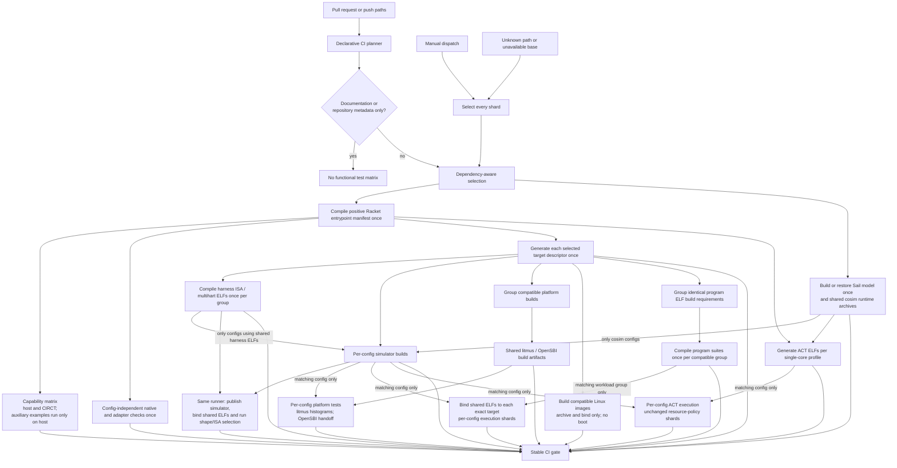

<!-- Defines test ownership, CI artifact reuse, and incremental bytecode validation. -->
<!-- SPDX-License-Identifier: Apache-2.0 -->

# Developing Rhodium tests

Read the [test-running guide](README.md) first for validation targets, focused
selectors, toolchain depth, and failure interpretation. This guide owns the
contributor rules for adding and maintaining tests.

## Test placement and ownership

There is no repository-level test package. Every test, fixture, emitter, bench,
and package-specific helper belongs under the lowest package that owns the
behavior, normally in `<package>/tests/`. Compiler tests therefore live under
`rhodium/core/tests/`, `rhodium/analysis/tests/`,
`rhodium/frontend/tests/`, `rhodium/backend/tests/`, and
`rhodium/formal/tests/`; domain tests remain under `flow/tests/`, `noc/tests/`,
`riscv/tests/`, `sw/tests/`, `cores/*/tests/`, and the corresponding package directories.

This directory owns only repository-wide test policy and reusable
orchestration. [`run-negative.rkt`](run-negative.rkt) is a package-neutral
diagnostic harness. [`circt/`](circt/DEVELOPING.md) owns external-tool
orchestration for HDL contracts. [`rsim/`](rsim/README.md) owns direct C++
orchestration; package-local `tests/rsim/` directories own behavioral drivers
and program-export fixtures. Package-local `tests/circt/` directories retain
HDL-specific benches and DPI companions. Canonical valid authoring programs belong under
[`../../examples/`](../../examples/README.md); invalid programs stay beside the
frontend or domain suite that owns their diagnostics.

When moving or adding implementation, move its tests with it and run
`make check-boundaries`. Do not create a new top-level `tests/` directory or
move package fixtures into `tools/testing/` merely because one runner consumes
them.

Representative compiler integration tests may reuse package-owned event and
UART DPI fixtures. Keep those artifacts with their original owners; their
foreign/runtime boundary requires HDL integration. Scalar and aggregate memory
semantics have dedicated backend differential oracles. The portable SyncRam
behavior suite belongs to rsim and has no duplicate SV bench.

Rsim behavioral fixtures are selected from `rsim/fixtures.tsv`. The
CI lanes cover standard-library/Flow and portable language behavior,
reusable and standalone named-core components, protocols/controllers, and HardFloat. They require a
C++20 compiler but neither CIRCT nor Verilator. Package changes select their
rsim owners; shared rsim or orchestration changes select all rsim lanes. HDL golden
and instrumentation lanes remain independently selected. Language behavior
includes arithmetic, aggregates, hierarchy, synchronous clocking, memories,
and assertion enable/reset behavior; the same examples retain their HDL
goldens. RV2Wide core/FP, cache, disabled-fetch, prediction, BHT, and MMU
scoreboards, enabled-fetch tracing, and RV32 integration belong to the core lane. RV5Stage composed behavior has separate frontend, control,
datapath, vector, memory, and cache groups, preserving the previous workload
split without HDL dependencies. Use the fixture inventory to select a group;
named-core tracing and FP/vector internal-port observers also run directly on
rsim; co-sim retains its separate HDL integration coverage. Hardware and instrumentation semantics belong on rsim;
retain HDL simulation for emission-sensitive contracts, including DPI ABI/context
and assertion/edge scheduling. Queue, pipeline, arbiter, demux, atomic-fork,
broadcast, join, stall/offer, retained-owner/window, crossbar, feedback, branching,
partial-tracing, OfferRegister, selected-parent, runtime-identity, and
retained-bank event suites use the language rsim group with the production
collector and exact public-transfer graph oracles. Traced Home/subordinate/FESVR, vector,
fetch, cache, page-walk, and multiply workloads use their corresponding rsim
protocol/core groups. Trace and collector changes select those groups as well.
Their optional targets and
link sources are declared in the same fixture inventory.

The host/backend lane also runs the small standalone rsim C++ fixtures, using
the runner's C++ compiler without HDL tools. The backend differential lane
compares the same fixtures through direct SV/Verilator. Rsim's sources, driver,
and independent oracles remain in `rhodium/backend/tests/rsim/`; its generated
models and native binaries are temporary artifacts. The rsim suite also runs
the production PTY UART integration; its UART/host/helper dependencies select
both host/backend and backend differential lanes.
The differential suite also checks the generated SV/DPI binding for rsim
using the unchanged `sims/TestDriver.v` and its native lifecycle runtime; changes
to that driver or runtime select the
backend differential lane. This binding proof requires Verilator and remains
outside the HDL-free rsim suite.

## Authoring principles

- A new hardware module does not require a dedicated test merely because it
  elaborates or passes `verify_design`. Successful compilation and elaboration
  are compiler responsibilities and should be covered once at representative
  integration boundaries, not repeated for every library component.
- For reusable hardware, use rsim tests of cycle-visible behavior:
  outputs, state transitions, reset, handshakes, backpressure, arbitration,
  ordering, faults, and protocol interactions. Drive the emitted C++ model
  directly, following the [rsim driver contract](rsim/README.md#driver-contract).
- Keep host tests for pure host algorithms and configuration, public
  elaboration-time rejection, specialization that removes or changes a public
  interface, and structural metadata consumed by another tool.
- Inspect exact operations, internal instance names, register names, or counts
  only when that IR is the compiler feature under test or an explicitly stable
  downstream contract. Incidental implementation shape is not behavior.
- Test supported behavior and invalid uses of supported features.
- Prefer semantic structure, opcodes, and types over generated temporary names.
- Use language-layer equivalence tests when syntax should lower to existing
  kernel or core meaning.
- Update Verilog references only when backend output changes intentionally, and
  review the example-source diff.
- Keep generated Racket, C++, CIRCT, SystemVerilog, and Verilator output out of
  version control.
- Reserve broader suites for cross-layer, shared-infrastructure, or complete
  backend-pipeline changes.
- Do not add tests of CI planning, workflow text or shell steps, Makefile
  recipes, mocked compilation, test-runner orchestration, build caches, or
  artifact packaging and reuse, or self-tests of repository hygiene checkers.
  Validate infrastructure changes through the
  actual affected build and behavioral test path. Keep production integrity
  checks and failure handling in the tools themselves.

## CI ownership

[`products.py`](../ci/products.py) declares products, direct inputs and consumers.
[`policy.py`](../ci/policy.py) defines which public configurations, checks and
workloads CI enrolls. [`plan.py`](../ci/plan.py) projects selected products onto
the Actions jobs; it does not maintain a second classifier. Core, shape, backend,
and instrumentation are distinct inputs. Keep incidental runner setup and
intentional test coverage out of build/cache identities.

For a change, walk towards consumers, select enrolled products, then walk back
to collect their prerequisites. Do not walk back out to siblings: a baseline
needs a simulator, but doesn't invalidate that simulator or select its other
workloads. Required inputs propagate changes; order-only prerequisites just
schedule work (for example, the mapped smoke runs on the Mini simulator job).
Coverage patterns select checks without making them prerequisites of a build.
Unknown paths select full CI. The stable gate rejects failed, cancelled or
unexpectedly skipped selected workflows.

Each software build root declares its direct source inputs and shared input
nodes. Native, platform, Linux-image, ACT, harness, and host-adapter consumers depend
on those roots and their execution contracts. Path classification follows reverse
dependency reachability; cache keys hash only the selected build root's forward
input closure, including pinned gitlinks. Thus a runner or expectation change
does not invalidate unrelated ELF builds. Add a suite's inputs and edges here
once, rather than updating multiple classifier branches and YAML hash lists.
ELF requests are per config/suite; their actual shared artifact identity is
determined by [`programs.py`](../ci/programs.py) from the generated target
descriptors. Never assume that config names prove or disprove compatibility.
Shared simulator-attestation and execution-evidence inputs retain their ACT and
simulator-producer consumers explicitly, without broadening unrelated port edits.

Simulator prerequisites are the union of the selected consumers' exact configs;
needing a DUT does not request its harness. Each simulator row explicitly carries
`run_harness` and its selected `software_tests`. Harness ELF producers and
platform producers are selected by their own suite lists. A litmus-only change
therefore selects only the enrolled four-hart litmus DUTs; a suite-owned benchmark
port change selects only the configs enrolled for that suite. Performance baseline
paths select their one config/suite, including the tiled multihart benchmark
harness. Host adapter-test edits run only their selected Python checks and
required source setup, without target generation or simulator builds.

Use the same graph locally, without bootstrapping a hardware toolchain:

```sh
python3 -m tools.ci.plan --paths cores/rv2wide/core.rhdl --pretty
python3 -m tools.ci.plan --affected sw/build/build-litmus.py --pretty
python3 -m tools.ci.plan --requires program:simple-rv5stage-rva23:coremark --pretty
python3 -m tools.ci.plan --products
python3 -m tools.ci.plan --make-dir vlsi --requires make:gds --pretty
python3 -m tools.ci.plan --make-dir sims --soc simple-rv2wide-rva23 --backend circt --trace --requires make:simulator
```

`--affected` gives an input-to-consumer chain; `--requires` distinguishes
inputs, coverage, prerequisites, and ordering. Local Make queries additionally
read GNU Make's *evaluated* explicit rules for that directory/configuration,
without running build recipes. They include phony targets, generated files
and order-only dependencies. Recipe-internal commands are not discovered this
way; declare cross-tool product handoffs explicitly. Make retains ownership
of timestamps, implicit rules and execution. Optional formal, physical, trace,
and other local flows are queryable without adding jobs to CI. Racket retains
ownership of its own incremental compilation and worktree cache.

Inspect the tracked source portion of a cache key with, for example,
`python3 -m tools.ci.plan --fingerprint build:coremark`. The same operation
supplies CI's installer, bytecode seed, Sail, ACT, software and Linux source
digests. It follows build inputs, not coverage or ordering edges. Runner ABI,
tool versions, workspace constraints, generated target digests, and actual
artifact integrity checks still belong to their producers. Manual/full CI
retains the complete coverage inventory.

Coverage selection and runner grouping are separate. `policy.py` retains one
entry per check and partitions those entries into compatible runner groups.
The planner includes only selected members, with tool requirements derived from
those members, so grouping never expands path-selected coverage. Each group
attempts all selected Make targets, retains a log per target, and fails if any
target fails. Heavy core-component and vector-configuration checks retain their
own jobs; related shorter host, rsim, and HDL checks share setup.

The config rows come from the single
[`simulator inventory`](../../sims/test-configs.txt); policy selects workloads
by shape and ISA, independently of core. Simulator matrices additionally carry
backend, cosim selection, and artifact identity. rsim is the default for every
enrolled config; the full shape/ISA workloads remain unchanged.
`BACKEND_SMOKE_VARIANTS` in `policy.py` adds a Simple RVA23 direct-SV variant
with three smoke tests and a CIRCT variant with smoke, boot,
host MMIO, UART, and ISA smoke. Only these explicit variants use narrowed
workload policy; ordinary backend selection never reduces coverage.
All simulator rows select `OPT_FAST=-O2`; initialization and Verilator runtime
compilation inherit it. Prebuilt consumers carry backend provenance explicitly
through software, ACT, platform, and harness jobs. Preserve optimization
propagation, bounded arguments, and nonzero status through log capture in the
actual build and run commands. CI retains build and harness logs.

Both RTL cores receive both variants with the same selection.
All Mini/Simple RV5Stage and RV2Wide rsim rows, plus their four HDL
variants, publish a cosim-enabled simulator under their config artifact name. Propagate
that selection to native ISA, ACT, and firmware consumers; verify the variant
and install GMP. Native and ACT runners require nonempty successful checking.
Cosim enrollment does not add matrix rows or change workload selection.
The existing RVA23 benchmark jobs also collect
[whole-ELF cycle measurements](../../sims/README.md#whole-elf-cycle-regressions).
Native shards and Tiled multihart harness jobs upload compact `performance-…`
artifacts and job summaries even on failure. With no checked-in config/suite
baseline they collect and report results without comparison; an existing baseline enforces the
per-ELF ±5% gate by config, suite, and test name, without baseline fingerprints.
RVA23 Simple/Tiled RTL simulator rows enable statistics in that same binary;
retirement, issue width, demand cache misses, and classified winning branch
recoveries follow the [counter baseline contract](../../sims/README.md#rtl-statistics).
The planner's `simulator_options` owns `cosim`, `stats`, and the exact `variant`
for simulator, native, ACT, and firmware consumers; do not reconstruct suffixes
independently in those consumers.
This adds no benchmark runs,
guest instrumentation, or trace jobs. Baselines are promoted explicitly from a
successful run's complete artifacts, never written by CI; their ownership and
qualification live in the [simulator contributor guide](../../sims/DEVELOPING.md#whole-elf-performance-baseline-maintenance).
When the plan selects any downstream work, CI
compiles the positive Racket entrypoint manifest once for reuse by the selected
jobs. Pull requests and pushes classify changed paths; manual dispatch selects
every matrix shard.

When any selected simulator enables cosim or ACT generation is selected, one
shared Sail producer runs alongside Racket compilation. It restores an exact-input
cross-run cache, builds or verifies the installed model, and saves the completed
cache before packaging or downstream tests can fail. The cache includes the
pinned compiler and installed model, keyed by the runner platform, Sail revisions,
ordered patches, installer, and CMake package definition. Simulator and ACT
generation jobs download the same exact-commit model artifact; they do not build
Sail or save competing caches. When cosim is selected, this producer also builds
the config-independent native runtime archives once, without test executables.
Simulator consumers verify archive checksums, native sources, platform, checkout,
and absolute link paths before linking. Generated runtime configuration and
`runtime/session.cc` remain config-specific. The stable gate requires the selected
Sail producer to succeed.

One target producer emits each selected SoC descriptor once.
Simulator, harness, program, and platform jobs consume these shared
descriptions; none may silently regenerate a missing artifact. Harness ISA smoke
and eight-hart benchmark builds use the existing suite-specific ELF projection
to group compatible configs, then bind each shared archive to the execution
target. Local build-and-run targets remain available; CI uses builder-free run
targets. Shared build failures retain diagnostics and do not cancel other groups.

Linux image production is selected independently of simulator execution.
`run_targets` and `target_configs` include both simulator and build-only software
requirements; a Linux-only change needs bytecode and target descriptions, not
Sail, simulators, native runtime builds, or software execution jobs.
`linux-plan` uses `programs.py --build-only` to group Simple RVA23 descriptors by
their Linux build specification and retain every compatible binding target.
`ci-linux-builds.yml` builds each group on `ubuntu-24.04` through `linux-elfs`,
using Buildroot's own Linux toolchain and the pinned OpenSBI source/patches.
It caches only hash-verified upstream downloads, starts compilation fresh, and
has a provisional 180-minute cold-build budget. Measure a successful cold build
before tuning the budget or introducing compiled-output caching.
The producer packages the common manifest archive, extracts it, and binds it
to every group member without executing any image. Successful bundles and
always-uploaded available build logs/configurations have seven-day retention;
the stable gate requires both Linux planning and production when selected.
Linux port/source/builder/workflow changes select only this producer chain;
shared target, firmware, and build-contract inputs also retain their existing
coverage. Full manual CI selects the producer too. No Linux boot, simulator,
or shutdown consumer is enrolled. Compilation and static artifact checks must
not be reported as Linux boot qualification.

One native-check job owns config-independent DPI, transport, runtime, cosim-hook,
and architectural projection tests. A separate lightweight software-adapter job
runs the graph-selected host checks and initializes only their required sources.
Native checks run their selected Make targets once and install tools from their
prerequisites. A branch-analysis edit runs its Python check without Racket,
FESVR, Verilator, or simulator construction; Spike ABI checks still use the
native toolchain, Racket, CIRCT and Verilator. Per-config hardware elaboration
and execution remain in their own jobs. The gate requires all selected shared
producers and native checks, including cancellation or unexpectedly skipped jobs.

Local runner scripts preserve the same freshness boundary with a persistent
compiled root owned by each worktree under `.rhodium-cache/`. The cache is keyed
by the Racket version, installed package metadata and checksums, operating
system, architecture, and absolute checkout path. The wrapper hashes repository
sources and uses Racket's recorded dependency graph to remove changed modules
and their transitive project dependents before incremental compilation. It also
records the source path inventory and clears only the checkout's mirrored
bytecode subtree when a source is added, removed, or moved, preventing orphaned
modules from surviving structural changes.

Mutable project bytecode and its lock are never shared across worktrees. An
explicit common `RHODIUM_RACKET_CACHE_DIR` still separates project roots by
absolute checkout path; only a completed external-dependency snapshot can be
shared, and checkout bytecode is removed before that snapshot is published.
Cache access is serialized within one worktree. The wrapper supervises the
cached command, releases its lock on interruption, reports long-running phases,
and fails without an uncached retry when the cache is unavailable or busy.
Callers that deliberately provide `PLTCOMPILEDROOTS` retain full ownership of
that root. Invalidation reads each reachable module's direct `.dep` record once
and walks reverse edges from changed sources or unreadable project metadata;
it deletes only project bytecode, and does not recursively rescan external
libraries for every source. Its summary reports cached, inspected, invalidated,
retained, and unreadable module counts.

CI first restores a checksum-pinned full Racket installer through the shared
`setup-racket` action. The compile job saves a verified installer immediately,
before downstream jobs start, so cold caches do not trigger parallel upstream
downloads. Every job verifies the SHA-256 again before installing at the same
Unix-style `/usr` paths; the runtime cache is separate from Rhombus packages and
project bytecode. Update the version, official checksum, and installer script
together when upgrading Racket; its content hash scopes the installer cache.

CI caches the entire completed compiled root and source manifests across runs,
including external bytecode updated by project compilation. The key scopes
reuse to the Racket/Rhombus environment, absolute workspace path, and cache
implementation. Restoring only project bytecode over an older dependency seed
would mix imported-dependency fingerprints and defeat warm reuse. The package
installation cache seeds cold builds; a completed-root cache replaces its
bytecode with the coherent snapshot from the previous build. Source-path changes
still clear only the checkout subtree, preserving external bytecode. CI then
applies the same content invalidation as the local wrapper and records total
compilation time. The cross-run cache is only a compilation starting point.
Downstream jobs consume a newly published exact-commit artifact, including hidden
package-cache paths, and verify its environment and absolute workspace path.



Known dependency paths can select several branches. For example, NoC, RISC-V,
CHI, core, and shared standard/flow library changes also select the SoC host shard
when their behavior feeds system composition. Backend implementation changes
retain differential coverage; fixture ownership comes from the runner inventories.
The direct lane
requires Verilator without CIRCT and runs the independent memory oracle; the
differential lane installs both and owns the full compiler behavioral families. Its
Builder fixtures, oracle, and runner live under
[`rhodium/backend/tests/verilog/`](../../rhodium/backend/tests/verilog/); see the
[backend contributor guide](../../rhodium/backend/DEVELOPING.md#validation). The
example manifest partitions execution: CIRCT loads and checks each declared
example source once in its owning lane, while `ci-host-examples-test` derives
the remaining non-formal examples by subtracting the manifest's source list.
Keep the local example targets for focused authoring checks; do not add a
second CI lane that merely reloads the same concrete designs. The foundation
host lane also executes standard-library, Flow, event, and diagram contracts;
the frontend and backend host owners execute their equivalence tests once.

CI uses the display groups `Checks`, `SoC / <config>`, `Platform / <config>`, and
`Software / <config> / <group>`, with short build and run names beneath each group. ACT execution
names include the config and shard. Shared ELF builds name the suite and matrix
group rather than implying ownership by the representative SoC. The final `CI`
gate name remains stable.

The root workflow calls `ci-simulator.yml` once per config. Each job
publishes its simulator, then runs that config's harness on the same runner,
reusing installed tools, native libraries, bytecode, and target descriptions.
Build and harness execution retain separate step budgets; the job result covers
both phases for the stable gate. Configs with downstream software or platform
tests have named root jobs so each consumer depends on its own simulator,
not the entire simulator matrix. Other simulator rows remain grouped by their
actual Sail and shared-harness-ELF dependencies. Non-cosim builds do not wait
for Sail; configs without shared harness software do not wait for harness ELFs.
Named dependency edges are necessary because Actions cannot express a
matching-row dependency between matrices. `plan.py` still derives config
selection and workload matrices from the owning inventory; when adding a
downstream config, add its named edges in `ci.yml`. The gate requires each
selected named producer and consumer, so a missing edge cannot silently omit it.

Native and platform planning/builds start from the target descriptions,
independently of simulator completion. Native producers are separated into
ISA, short suites, Bringup-Bench, SKL, and Highway; short RVA23 runs wait only
for ISA and short-suite producers, while RV32 runs wait only for ISA.
OpenSBI and litmus have separate producer dependencies. Shared compatible ELF
groups within a producer still finish before that producer's consumers start;
there is no wait for another workload family. ACT generation starts alongside
simulator builds, once bytecode and Sail are ready, and each config's shards
wait only for that config's generator and simulator. No runner polls for an
artifact whose producer is still running.
Producers upload build logs and Verilator pass statistics independently of their
simulator artifacts, including on failure. `ci-platform-builds.yml` owns shared
platform compilation and `ci-platform.yml` owns execution, independently of backend
fixtures. Each OpenSBI test has its own
job budget and uses the matching exact-commit single-core simulator artifact,
so firmware execution cannot consume another SoC's or the harness job's budget.
That workflow groups litmus builds by software requirements and OpenSBI builds
by minimum firmware ISA and derived boot layout. Each execution supplies its
own BootROM DTB; firmware neither embeds nor binds to a separate DTB. Litmus7 and target compilers
belong only to build jobs, and the common ELF archive/binder feeds all compatible
execution configs. Each `tiled4core` config runs the same bounded, model-checked
litmus7 selection with its independent 90-minute budget; OpenSBI retains a
45-minute budget per single-core config. Both retain build diagnostics and
runner results even on failure. The full litmus inventory is manual only and has
no CI job or schedule. Do not remove smoke cases because they expose a failure.
The `tiled8core` configs retain platform smoke, ISA smoke, and eight-hart
benchmarks, but do not repeat litmus execution. Keep named simulator and
consumer dependencies explicit for both tiled sizes.

Core rsim coverage retains frontend, control, datapath, both functional vector
shards, alternate vector configurations, memory, and cache selections. Compatible
selected targets share runner groups; fixture inventories and local targets are
unchanged. HardFloat uses the same rsim runner through its package-owned target.
Retained CIRCT fixtures share an HDL job for emission, trace/runtime, and
observation contracts; selected direct and differential SystemVerilog checks
share their own job. Only the selected members determine tool installation.

All Simple RVA23 single-core software matrices independently select ISA tests,
benchmarks, both CoreMark variants, Embench-IoT, SKL and Highway vector execution workloads,
and the complete bounded Bringup-Bench inventory. SKL uses the upstream capability-filtered
catalog without X390 or standalone scalar suites. SKL retains all test-input and
benchmark cases but disables numerical verification and reference-buffer setup.
Both RTL jobs require Sail cosim for architectural checking; Spike is an
execution smoke test, not an independent numerical oracle.
Highway uses repository-owned bounded drivers linked with the pristine upstream
library, not modified hosted benchmarks. All benchmark families use the same
single profile on each core. Its CMake/G++ build runs only in the shared producer;
execution consumes the ordinary checksum-bearing ELF archive and bound manifest.
`programs.py` projects generated target descriptors into suite build groups;
`ci-program-builds.yml` compiles each group once and distributes one ELF archive to all compatible
configs. Each run binds the archive to its own full target fingerprint and
checks its simulator attestation. Compiler installation and ELF caches belong
only to the build jobs; execution shards retain every selected test.
Short ISA, benchmark, CoreMark, scalar CoreMark, and Embench suites share one
execution job per exact config. Each suite still consumes its own shared ELF
archive and retains its manifest, runner limits, results, logs, and performance
identity. A preparation or execution failure does not skip later suites; the
group fails after all selected suites have been attempted. SKL, Highway, and
Bringup-Bench keep independent execution jobs. Grouped artifact names identify
the config and group; their directory trees retain the separate suite records.

Bringup-Bench uses four shards and two workers per shard on every eligible
config, including Spike. `policy.py` owns the suite's shard count;
`programs.py` expands execution only after grouping compatible ELF builds.
Each shard publishes separate diagnostics, and all shards are required for the
CI gate to succeed. Do not add core-specific selections or rebuild
the suite per shard.
Software adapter contracts run once in their independent selected host job. A failed build does
not prevent execution jobs from attempting other published groups.
Each selected OpenSBI execution
validates its enrolled single-core config and
publishes separate diagnostics. A failed platform build does not prevent
execution jobs from attempting other published build groups.
All six Simple RV32 configs select upstream ISA tests;
the existing RV64-only benchmark ports remain outside their coverage.
Selected Simple RV32/RVA23 configs retain their own ACT generation and execution.
ACT shard counts are unchanged by runner grouping. Counts live in `tools/ci/policy.py` and
only split execution; each profile still generates one shared ELF archive and
builds one simulator. Shared SoC dependencies
(including CHI, NoC, devices, and RISC-V support) select these lanes; suite-only
adapter/source changes select the owning lane. Enrolled Mini and Tiled
configs receive capability-filtered ISA smoke. The `rv64max`, `rv64imacb`, and
`rv64imafdcb` presets enroll their paired Simple configs; both RTL cores also
enroll Mini for the two lean presets. These run only ISA smoke, without ACT,
benchmarks, or platform tests. Both RTL cores use the same shape/ISA inventory,
enforced by the planner, with cosim enabled on Mini/Simple. All three Tiled cores run the
eight-hart benchmark manifests in CI. Harness execution reuses the simulator
producer's hardware tools and native libraries; only standalone platform payloads
need the RISC-V compiler on that runner. ISA smoke consumes shared ELF archives
and the producer's target descriptor, retaining ordinary manifest and simulator
checks. Mapped MiniRV5Stage checks retain their additional compiler dependencies.
Native DPI and transport checks run once in the shared native job.
Software selection is a
function of SoC shape and ISA, never core identity. No timeout or prior failure
removes a workload from one core. None receives the full
single-hart suite matrices. ACT configuration
generation uses the exact compiled root; ISA/benchmark/CoreMark/Embench-IoT/Bringup-Bench execution needs only the
shared ELF archive and native simulator artifact. Bare-metal software builds use the same pinned
GCC/Newlib toolchain; Linux image production uses Buildroot's Linux/musl toolchain.
ACT execution consumes its shared ELF archive without installing
the compiler or reference-model toolchain again. Generation can reuse only an
exact-input, checksum- and inventory-verified complete bundle; execution still
verifies the current commit's simulator. Native software and ACT shards may reuse
checksum-verified raw execution evidence under the
[simulation reuse contract](../../sims/DEVELOPING.md#content-addressed-execution-evidence).
Current functional checks, Sail completion, inventory accounting, and performance
expectations still run; a cache hit never skips the job's verdict. Only trusted
`main` runs publish complete functional evidence, with exact-key restore and a
force-fresh dispatch option. Optional cache transfer failures may continue; test
failures may not. Platform, harness, multihart, and litmus jobs execute freshly.
The configured deterministic shards cover
the full generated inventory, including failures. They run independently with bounded process parallelism and
upload logs plus JSON/JUnit results even when execution fails. Do not add
`continue-on-error` or pass-based exclusions to make new suites green. Measure a
complete Linux run and resolve baseline failures before marking the new jobs
required in branch protection. Platform/privileged ACT coverage limits remain
in the [simulation guide](../../sims/README.md#architectural-certification-tests).
The program suites and ISA-smoke jobs publish manifest-selected ELF archives
with their diagnostics; package by manifest entry rather than filename suffix,
since upstream ISA binaries have no extension. The ordinary simulation jobs
also attach their standalone hand-written ELFs.

Recognized documentation and inert repository metadata select no functional
test jobs. The optional Emacs integration and most of `vlsi/` have no
functional CI lane; Rhodium sources there still receive source hygiene, while
`vlsi/sim/` and the mapped MiniRV5StageSoC flow select simulation. Unrecognized
paths fail closed by selecting every lane; tracked executable inputs must select
their affected owners. The root workflow owns only triggers,
planning, the shared Racket and Sail artifacts, reusable-workflow calls, and the stable
`CI` gate. The reusable workflows separately own capability checks, simulator
construction, simulation, and bare-metal software. Composite actions own only
repeated toolchain setup, so test steps and their failures remain visible as
workflow jobs.

The hygiene lane runs `make check-license-headers` over the complete tracked
source, test, script, configuration, and documentation inventory. It requires
Apache-2.0 identifiers for original Rhodium material and BSD-3-Clause
identifiers within `hardfloat/`, while exempting exact legal texts and external
submodule contents.

When adding or moving executable source, update the planner if its existing
dependency rules do not select every affected owner. Inspect the plan with
`python3 -m tools.ci.plan --paths PATH... --pretty` and run the affected build
and behavioral tests.

## Change workflow

1. Put the test beside the layer or package that owns the behavior.
2. Before adding a host test, state what regression it catches beyond successful
   elaboration. If the answer is only internal shape, add or extend an
   end-to-end simulation instead.
3. Add valid executable examples to the owning example group and invalid
   language uses to the frontend-invalid suite.
4. Add external lowering or simulation coverage through the
   [CIRCT fixture workflow](circt/DEVELOPING.md) only when the change crosses
   that toolchain boundary.
5. Confirm `python3 -m tools.ci.plan --paths PATH... --pretty` selects every
   affected package, example, CIRCT, simulation, or software lane.
6. Run the smallest owner target first, then the broader target required by the
   changed dependency surface. The [test-running guide](README.md) lists those
   targets and their scope.
