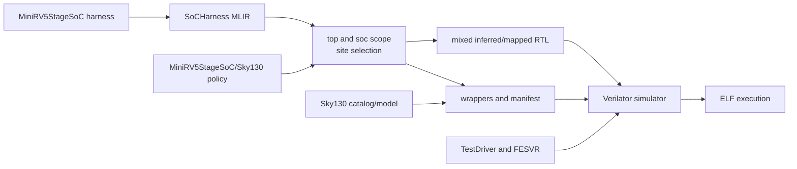

<!-- Guides contributors through maintaining mapped MiniRV5StageSoC simulation orchestration. -->
<!-- SPDX-License-Identifier: Apache-2.0 -->

# Developing mapped VLSI simulation

Read the mapped-simulation [README](README.md) for tool setup, mapping reports,
build/run commands, artifacts, and failure diagnosis. This guide owns the
orchestration boundary, supported configuration, build graph, and validation.

## Architecture and ownership

This directory combines, but does not redefine:

- the MiniRV5StageSoC harness, TestDriver, FESVR, and target execution from
  [`../../sims/`](../../sims/DEVELOPING.md);
- memory-site selection, mapping, wrappers, and manifests from
  [`../../sram/`](../../sram/DEVELOPING.md);
- the Sky130 catalog and functional model from
  [`../../sram/sky130/`](../../sram/sky130/DEVELOPING.md); and
- MiniRV5StageSoC/Sky130 policy and manifest assertions from
  [`../`](../DEVELOPING.md).

It owns only their harness-scoped orchestration and isolated artifacts. The
supported matrix is deliberately one point: `SOC=mini-rv5stage-soc`, `TECH=sky130`.

## Implementation map

[`physical-build.yml`](../../.moon/tasks/physical-build.yml) owns artifact production.
Moon's `mapped-smoke` and `mapped-run` tasks own execution. The
principal stages are:



Keep the generated inventory, wrappers, manifest, RTL,
cached inputs beneath `vlsi/build/sim/mini-rv5stage-soc/sky130`. The compiler
work tree and staged smoke ELF respect `BUILD_ROOT`; unchanged inputs are not rewritten.
Link `sims/verilator/simulation_runtime.cc` with the shared `TestDriver.v`, even
without optional instrumentation. It supplies the generic driver lifecycle; do
not fork the driver or duplicate cosim/tracing feature decisions here.

## Change the mapped simulator

1. Add a new system or technology only after its normal simulator harness,
   site policy, catalog, functional model, and design-specific manifest checker
   exist independently.
2. Scope a design-relative policy through the harness instance explicitly;
   preserve stable wrapper identity and validate both logical and actual paths.
3. Compile selected wrappers with zero-delay functional models only. Do not use
   PDK timing or physical views as a substitute for cycle semantics.
4. Keep target loading and execution in the shared simulator stack and keep
   physical assertions in the parent VLSI flow.
5. Add isolated artifacts and explicit Moon stage outputs for any expanded matrix.
6. Update [README.md](README.md) when operators gain a supported configuration,
   command, variable, artifact, or debugging path.

## Focused validation

Validate selection, wrappers, and manifest without building the simulator:

```sh
moon run rhodium:memory-map
```

Include CIRCT RTL lowering with:

```sh
moon run rhodium:mapped-rtl
```

Validate the complete compiled execution path with:

```sh
moon run rhodium:mapped-smoke
```

Compare against `SOC=mini-rv5stage-rva23 moon run rhodium:sim-smoke` when diagnosing whether a failure
belongs to shared simulation or mapping. Mapping requires CIRCT, the SRAM pass,
Python, and Verilator; execution additionally requires FESVR and the RISC-V
cross compiler. Generated artifacts are not checked in.
